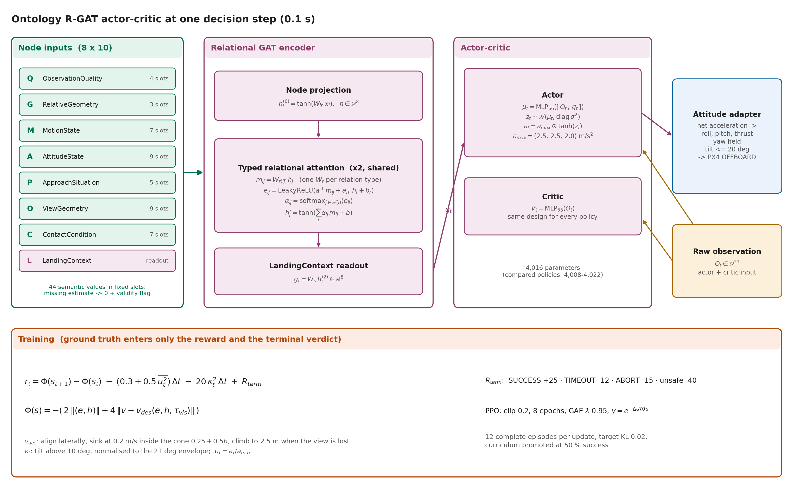
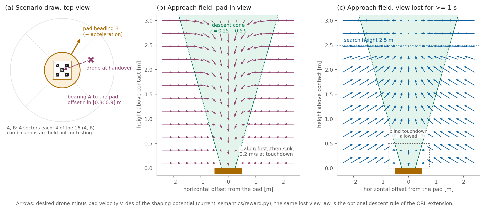
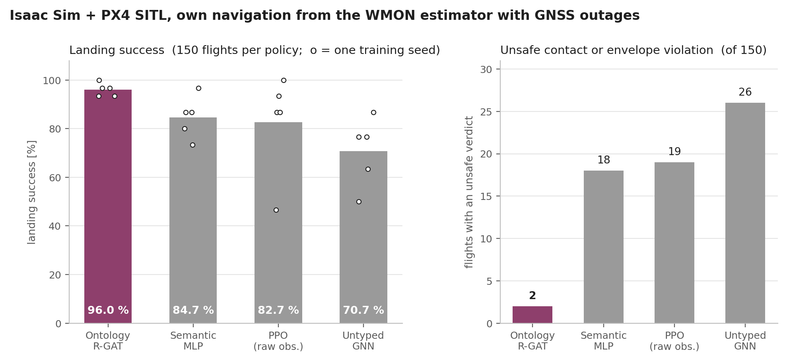

# 온톨로지 기반 관계 그래프 어텐션 강화학습을 이용한 이동 플랫폼 UAV 착륙

이동하는 지상 플랫폼(UGV) 위에 쿼드로터를 착륙시키는 강화학습 정책이다.
정책은 매 결정 시점의 현재 관측만 받아 월드 좌표계 3축 순가속도 `(a_x, a_y, a_z)`를 낸다.
현재 관측은 카메라 기반 패드 추정값과 자기 항법 상태로 이루어진다.

관측을 그대로 쓰지 않고 착륙 온톨로지로 구조화한다. 다루는 개념은 다음과 같다.

- 관측 품질
- 상대 기하와 운동
- 시야 기하
- 접지 조건

관계 그래프 어텐션망(R-GAT)은 이 개념 그래프 위에서 관계 유형별로 메시지를 전달한다.
그 결과 착륙 상황을 8차원 임베딩 하나로 요약하고, 정책은 이 임베딩을 원 관측과 함께 읽는다.

검증은 Isaac Sim + Pegasus + PX4 SITL + ROS 2 폐루프 비행으로 한다. 비교 정책 세 가지는 파라미터 수, 보상, 학습 예산이 제안 방법과 같다.

> **핵심 결과**
>
> 온톨로지로 관측 품질, 상대 운동, 착륙 조건을 구조화하고, R-GAT 상태 표현을 강화학습 정책에 적용했다.
> Isaac Sim–PX4 폐루프에서 GNSS 결측으로 항법 신뢰도가 떨어진 조건을 평가했다.
>
> - 착륙 성공률: **96.0 %**. Semantic MLP는 84.7 %, 일반 PPO는 82.7 %, Untyped GNN은 70.7 %이다.
> - 위험 판정: 150회 비행 중 **2건**. Semantic MLP는 18건, 일반 PPO는 19건, Untyped GNN은 26건이다.


---

## 1. 문제 설정

- **이동 플랫폼:** 패드의 조건은 다음과 같다.
  - 정책 인계 시점에 드론과 패드 사이의 방위(A)와 패드 진행 방향(B)은 전 방향(4개 구역씩)에서 뽑는다.
  - 패드는 가속 운동을 할 수 있다.
  - 패드에는 17개 태그로 된 ArUco 보드가 있다.
- **3축 가속도 제어:** 정책의 행동은 월드 ENU 좌표계의 순가속도이다.
  - 자세는 행동에서 유도되며, 롤·피치·추력으로 바뀌고 요는 고정한다. 정책이 따로 학습하지 않는다.
  - 2축(종·수직) 상대 운동 착륙 문제를 수평 2축 + 수직 1축으로 확장한 형태이다.
- **현재 관측만 사용:** 정책 입력은 현재 시점의 21채널 관측 `O_t`이다.
  - 이력, 적분항, 이전 행동, 교사 신호는 넣지 않는다.
  - 패드 추정이 없거나 오래되었다는 사실은 관측 안의 품질 채널(시야 나이, 항법 유효·나이)로 드러난다.
- **항법 열화:** 자기 위치·속도는 GNSS + 속도 + IMU를 융합한 항법 추정기가 낸다.
  - GNSS는 10 Hz이고, 에피소드마다 1–4 s 결측 창이 들어간다.
  - 결측 중에는 추정 오차가 커지고, 그 오차가 패드 상대 추정과 정책 입력으로 전파된다.
- **참값은 보상과 판정에만 쓴다.** 시뮬레이터 참값은 정책, 가치함수, 그래프 입력 어디에도 들어가지 않는다.
- **착륙 판정:**
  - SUCCESS: 패드 위에서 접지하고, 접지 속도가 |v_z| ≤ 0.30 m/s, |v_xy| ≤ 0.35 m/s이며, 추력축 기울기가 21° 미만인 경우
  - UNSAFE_CONTACT: 접지했지만 속도 한계를 넘은 경우
  - SAFETY_ENVELOPE_VIOLATION: 비행 중이나 접지 시 기울기가 21°를 넘은 경우
  - MISSED_PAD_CONTACT: 패드 밖에 접지한 경우
  - TASK_TIMEOUT: 제한 시간을 넘긴 경우

  이 문서에서 **위험 판정**은 UNSAFE_CONTACT와 SAFETY_ENVELOPE_VIOLATION을 합한 것이다.

## 2. 제안 방법



### 2.1 착륙 온톨로지


착륙에 필요한 지식을 개념 8개와 관계 유형 5개로 정의한다. 개념은 세 층으로 나뉜다.

1. 관측된 상태 (Q·G·M·A)
2. 착륙 상황 (P·O·C)
3. 결정 맥락 (L)

| 개념 | 담는 내용 | 슬롯 |
|---|---|---:|
| ObservationQuality (Q) | 시야 갱신 여부·시야 나이, 항법 유효·항법 나이 | 4 |
| RelativeGeometry (G) | 패드 대비 상대 x, y, 높이 | 3 |
| MotionState (M) | 상대 속도, 패드 속도, 자기 속도, 수직 속도 | 7 |
| AttitudeState (A) | 롤·피치·요(sin, cos), 각속도 | 9 |
| ApproachSituation (P) | 접근 오차, 접근 속도, 접근 폐합률 | 5 |
| ViewGeometry (O) | 패드의 영상 좌표와 그 변화율, 영상 네 경계까지의 여유, 카메라 전방 여부 | 9 |
| ContactCondition (C) | 접지 기준 위치·속도 오차, 수직 속도, 기울기, 각속도 | 7 |
| LandingContext (L) | 입력 없음. 관계로만 상태가 정해지는 판독 노드 | 0 |

| 관계 유형 | 간선 | 의미 |
|---|---|---|
| `qualifiesEstimate` | Q → P, O, C | 관측 품질이 파생 상황의 신뢰도를 한정한다 |
| `informsApproach` | G, M → P | 상대 기하와 운동이 접근 상황을 정한다 |
| `affectsVisibility` | G, M, A → O | 위치·운동·자세가 패드의 화면 위치와 이탈 여유를 정한다 |
| `conditionsContact` | G, M, A → C | 위치·운동·자세가 접지 가능 조건을 정한다 |
| `informsLanding` | P, O, C → L | 세 착륙 상황이 결정 맥락을 이룬다 |

모든 노드에 자기 루프가 있다. 그래프는 다음 성질을 갖도록 설계했다.

- 관측된 개념(Q·G·M·A)은 착륙 상황(P·O·C)을 거쳐 **정확히 2홉**에 L에 닿는다. 인코더는 같은 관계 층을 두 번 적용한다.
- O → C 같은 상황 사이의 지름길은 두지 않았다.
- 관계 이름은 학습되는 가중치를 고르는 데만 쓴다. 규칙으로 실행되지 않는다.

### 2.2 의미 특징과 유효성 규칙

- 21채널 관측을 44개 의미 특징 φ(O_t)로 바꾼다. φ는 순수 함수이며, 노드마다 정해진 슬롯에 들어간다.
- 원 관측 채널은 손대지 않고 그대로 복사한다.
- 파생 특징은 모두 하나의 유계 사상 `B(x; s) = x / (|x| + s)`를 거친다. 여기서 s는 물리 단위의 등록된 척도이다.
- 파생 특징의 예는 다음과 같다.
  - 접근 오차와 폐합률
  - 핀홀 투영으로 계산한 패드 영상 좌표 (ξ, η)와 그 변화율
  - 영상 경계까지의 여유
  - 접지 한계 대비 속도와 기울기
- **유효성 규칙:** 해당 조건이 성립할 때만 특징을 계산한다. 성립하지 않으면 특징은 중립값 0이고, 같은 벡터 안의 플래그가 그 이유를 알린다. 따라서 0이 정렬된 상태로 오인되지 않는다.
  - 패드 추정이 유효해야 하는 특징과, 카메라 앞쪽에 패드가 있어야 하는 특징이 있다.
- 노드 입력은 8 × 10 행렬이다. 각 행은 그 노드의 슬롯과 노드 식별자로 이루어진다.

### 2.3 관계 그래프 어텐션 인코더

노드 i의 입력 x_i는 다음 순서로 처리된다(은닉 차원 8).

```
h_i^(0) = tanh(W_in x_i)
m_ij    = W_r(ij) h_j                                   관계 유형마다 W_r 하나
e_ij    = LeakyReLU(a_sᵀ m_ij + a_dᵀ h_i + b_r(ij))
α_ij    = softmax_{j ∈ N(i)} e_ij                       노드 i로 들어오는 간선에 대해서만
h_i'    = tanh(Σ_j α_ij m_ij + b)                       같은 층을 2회 적용
g_t     = W_o h_L^(2) ∈ R^8                             LandingContext 판독
```

- **관계별 변환:** 의미가 다른 메시지를 서로 다른 선형 사상으로 옮긴다.
  - 예를 들어 Q→O(품질이 시야를 한정)와 G→O(위치가 시야를 정함)는 같은 노드로 들어가지만 다른 변환을 거친다.
  - 같은 간선을 관계 이름 없이 쓰는 Untyped GNN과 구조가 다른 점은 이것 하나이다.
- **어텐션:** 들어오는 메시지의 상대적 비중을 상태에 따라 정한다.
  - 예: 시야 품질이 낮으면 시야 기하에서 오는 메시지의 비중이 바뀔 수 있다.
- **층 공유:** 두 홉이 같은 층을 쓴다. 홉 수는 표현력이 아니라 도달 범위를 정하며, 파라미터는 늘지 않는다.
- **판독:** 입력이 없는 L의 최종 상태를 읽는다. 따라서 g_t는 세 착륙 상황의 관계적 결합만으로 정해진다.

### 2.4 정책과 비행 제어

- **Actor:**
  - μ_t = MLP([O_t ; g_t])
  - 잠재 행동 z_t ~ N(μ_t, diag σ²)
  - 실제 행동 a_t = a_max ⊙ tanh(z_t), a_max = (2.5, 2.5, 2.0) m/s²
  - PPO가 평가하는 행동과 환경이 받는 행동이 같다. 감독기가 행동을 다시 쓰지 않는다.
- **Critic:** V_t = MLP(O_t). 모든 비교 정책이 같은 설계를 쓴다.
- **파라미터 예산:** 제안 정책은 4,016개, 비교 정책은 4,008–4,022개이다.
- **비행 제어:** 순가속도를 롤·피치·추력으로 바꾸고 요를 유지한다. 명령 기울기는 20°로 제한한다.
  - 명령은 PX4 OFFBOARD로 전달된다. 결정 주기는 약 10 Hz이다.

### 2.5 학습



- **보상:**

  ```
  r_t = Φ(s_{t+1}) − Φ(s_t) − (0.3 + 0.5·mean(u_t²))Δt − 20 κ_t² Δt + R_term
  Φ(s) = −( 2‖(e, h)‖ + 4‖v − v_des(e, h, τ_vis)‖ )
  ```

  - **접근 속도장 v_des:**
    - 기본 동작: 수평으로 패드에 정렬한다. 반경 0.25 + 0.5h의 하강 원뿔 안에서만 하강하고, 접지 직전 하강 속도는 0.2 m/s이다.
    - 시야를 잃으면 탐색 높이 2.5 m까지 상승한다. 단, 높이 0.5 m 이하이면서 중심 0.75 m 이내인 마지막 구간은 예외이다.
  - 위치 퍼텐셜만 쓰면 가속도 행동은 두 번 적분된 뒤에야 보상에 반영된다. 속도 오차 퍼텐셜은 한 결정 주기 안에 반응하므로 신용 할당을 돕는다.
  - u_t = a_t / a_max이다. κ_t는 10° 이상의 기울기를 21° 한계로 정규화한 값이다.
  - R_term: SUCCESS +25, TASK_TIMEOUT −12, SAFE_ABORT −15, 위험·패드 이탈 접지 −40
- **PPO:**
  - 업데이트마다 완결 에피소드 12개를 모은다.
  - 클립 0.2, 8 에폭, GAE λ 0.95, 목표 KL 0.02
  - 할인은 실제 전이 시간으로 γ = exp(−Δt / 70 s)이다.
- **커리큘럼:** 난이도 0에서 시작한다. 최근 성공률이 50 %를 넘으면 0.1씩 올린다. 검증과 시험은 언제나 난이도 1이다.
- **학습 무작위화:** 학습 에피소드에만 넣는다.
  - 절반의 에피소드에 시야 차단(1–3 s)을 넣는다.
  - 인계 직후 감쇠하는 자기 속도 오차(수평 최대 1.5 m/s)를 넣는다.
- **학습 플랜트:** Isaac/PX4의 응답에 맞춰 보정한 로컬 플랜트에서 학습한다. 보정 대상은 자세 응답, 지연, 광학 검출 모델, 접지 높이이다.
  학습된 체크포인트는 수정 없이 Isaac Sim + PX4에서 평가한다.

### 2.6 확장: 온톨로지 구조 정책 (ORL)


온톨로지를 상태 표현에 더하는 데 그치지 않고 정책 구조 자체로 쓰는 확장이다. 구조적 편향 네 가지를 둔다.

1. **국소성:** 원 관측 우회 경로가 없다. 행동에는 온톨로지 노드와 선언된 관계를 거친 정보만 닿는다.
2. **가중치 공유:** x·y 수평 평면은 같은 개념의 두 사례로 본다. 두 평면이 노드 인코더, 관계 가중치, 수평 판독을 공유한다.
3. **거울 등변성:** 개념마다 두 거울 반사에 대한 패리티를 선언한다. 행동 평균은 네 반사에 대한 군 평균으로 구하므로, 반사된 상태에는 반사된 명령이 나온다.
4. **도메인 규칙의 구조화:** 수직 명령에서 하강은 학습되는 게이트를 거친다.
   - 시야 나이, 추정 높이, 정렬 원뿔로 정의한 시야 상실 규칙이 닫히면 하강이 억제된다. 이때 수직 명령은 탐색 높이를 향한 속도 댐퍼가 된다.
   - 이 규칙은 정책의 자기 추정만 읽으며, 2.5절의 보상 속도장과 같은 상수를 쓴다.

같은 입력(44개 의미 특징)과 같은 예산의 MLP와 비교한 결과는 다음과 같다. 학습 시드는 5개이다.

| 비교 | 지표 | 결과 |
|---|---|---|
| ORL vs MLP (둘 다 규칙 없음) | 최고 난이도에 도달한 업데이트 수 | 평균 70 vs 98 |
| ORL + 규칙 vs MLP + 같은 규칙 | 최고 난이도에 도달한 업데이트 수 | 평균 57 vs 66. 5개 시드 모두 빠름(차이 95 % 구간 [−12.6, −6.6]) |
| ORL + 규칙 vs MLP + 같은 규칙 | 10개 평가 셀 평균 성공 | 87.4 % vs 85.7 %. 차이는 통계적으로 확립되지 않음 |
| ORL + 규칙 vs MLP + 같은 규칙 vs 규칙 없는 MLP | 장시간 시야 차단 셀(3–4 s) 성공 | 95.6 % vs 93.0 % vs 70.8 % |

## 3. 검증

### 3.1 시뮬레이션 환경

| 항목 | 설정 |
|---|---|
| 시뮬레이터 | Isaac Sim 5.1.0 + Pegasus Simulator, lockstep 물리 |
| 기체 | Iris 쿼드로터, 하방 카메라. 에피소드마다 시드로 정한 외력·외란 토크와 인계 속도 교란이 있다 |
| 비행 제어기 | PX4 v1.14.3 SITL, OFFBOARD 자세·추력 설정값 |
| 미들웨어 | ROS 2 Humble (Isaac ROS 2 브리지, 카메라·상태 토픽) |
| 착륙 패드 | UGV 위 17-태그 ArUco 보드 (세 가지 크기) |
| 패드 인식 | ArUco 검출 + PnP, 촬영 시각 정렬, 반복 거부 후 추적 재획득 |
| 항법 열화 | GNSS 10 Hz, σ = (0.3, 0.3, 0.5) m. 에피소드마다 2–6 s에서 시작하는 1–4 s 결측 창. 속도 σ 0.05 m/s, IMU σ 0.2 m/s² |
| 항법 추정기 | 기준 항법(PX4 EKF), 칼만(등가속도), WMON |

### 3.2 비교 정책

네 정책은 다음을 모두 공유한다.

- 보상, 판정, PPO 설정, 커리큘럼
- 학습 시드(5개), 학습 예산(600 업데이트 × 12 에피소드)
- 가치함수 설계, 평가 케이스

| 정책 | Actor 입력 | 차이 |
|---|---|---|
| **Ontology R-GAT (제안)** | O_t + g_t (관계 유형이 있는 그래프) | – |
| Untyped GNN | O_t + 같은 간선의 그래프 판독 | 관계 이름을 지움(관계 유형 1개) |
| Semantic MLP | 44개 의미 특징 | 그래프 구조 없음 |
| PPO (raw obs.) | O_t (21채널) | 의미 특징과 그래프 없음 |

### 3.3 평가 조건

- **Isaac 폐루프:** 조건 3개 × 환경 시드 10개 × 학습 시드 5개로, 정책마다 150회 비행한다. 모두 결정론적 평가이다.
  - 조건 1: 학습 분포 안의 방향 조합
  - 조건 2: 학습에서 제외한 방향 조합
  - 조건 3: 시야 차단 + 패드 가속
- 항법 추정기만 바꾸고 같은 케이스를 다시 비행해 서로 짝지어 비교한다.
- **로컬 평가 셀 10개:** 셀마다 학습 시드별 100 에피소드이다.

| 셀 | 분포 안 (ID) | 분포 밖 (OOD) |
|---|---|---|
| composition | 학습한 (A, B) 조합 | 제외한 조합 |
| motion | 기본 패드 운동 | 패드 가속 0.6–0.9 m/s² |
| dropout | 시야 차단 1–3 s | 시야 차단 3–4 s |
| noise | 기본 광학 잡음 | 광학 잡음 5배 |
| combined | 시야 차단 1–3 s | 가속 + 3–4 s 차단 + 잡음 5배 |

### 3.4 결과

#### 항법 열화 조건의 Isaac Sim + PX4 폐루프 (WMON 항법, GNSS 결측)



| 정책 | 착륙 성공 | 위험 판정 | 그 밖의 실패 |
|---|---:|---:|---|
| **Ontology R-GAT (제안)** | **144 / 150 (96.0 %)** | **2** | 패드 이탈 3, 시간 초과 1 |
| Semantic MLP | 127 / 150 (84.7 %) | 18 | 시간 초과 5 |
| PPO (raw obs.) | 124 / 150 (82.7 %) | 19 | 패드 이탈 4, 시간 초과 3 |
| Untyped GNN | 106 / 150 (70.7 %) | 26 | 패드 이탈 5, 시간 초과 13 |

- 다른 정책의 위험 판정은 대부분 UNSAFE_CONTACT이다. 하강 속도나 수평 속도가 한계를 넘었다.
- 제안 정책의 위험 판정 2건은 기울기 한계 위반이다.

#### 항법 신뢰도에 따른 성능 저하


같은 케이스를 세 항법으로 비행한 결과이다. 학습 시드 5개, 환경 30개로 정책마다 150회이다.
Semantic MLP는 세 항법 모두에서 학습된 시드 3개만 비교하므로 90회이다.

| 정책 | 기준 항법 | 칼만 | WMON | 기준 → WMON |
|---|---:|---:|---:|---:|
| **Ontology R-GAT** | 99.3 % | 96.7 % | 96.0 % | **−3.3 pp** |
| PPO (raw obs.) | 98.7 % | 94.7 % | 82.7 % | −16.0 pp |
| Semantic MLP | 97.8 % | 95.6 % | 80.0 % | −17.8 pp |
| Untyped GNN | 98.0 % | 93.3 % | 70.7 % | −27.3 pp |

- 기준 항법에서는 네 정책 모두 98–99 %로 비슷하다. **차이는 항법이 나빠질수록 커진다.**
- 열화 폭이 가장 작은 정책은 제안 정책이다.
- 같은 간선을 쓰는 Untyped GNN보다 열화가 크게 작다. 두 정책의 구조 차이는 관계 유형 구분 하나뿐이다.

로컬 평가 셀 10개의 평균 성공률이다(학습 시드 5개 평균).

- 기준 항법과 WMON에서는 제안 정책이 가장 높다.
- 칼만에서는 PPO와 같은 수준이다(73.2 % vs 73.0 %).
- 항법이 가장 나쁜 WMON에서 격차가 가장 크다.

| 정책 | 기준 항법 | 칼만 | WMON |
|---|---:|---:|---:|
| **Ontology R-GAT** | **78.6 %** | 73.2 % | **69.6 %** |
| Semantic MLP | 77.2 % | 45.5 %\* | 59.1 % |
| PPO (raw obs.) | 75.6 % | 73.0 % | 62.5 % |
| Untyped GNN | 75.6 % | 70.8 % | 50.3 % |

\* 칼만 항법에서 Semantic MLP의 시드 2개는 예산 안에 최고 난이도에 도달하지 못해 0으로 집계되었다. 학습된 3개 시드만의 평균은 75.9 %로, 제안 정책보다 높다.

#### 해석 범위

- 학습 시드 5개 기준으로 시드별 짝지은 차이의 95 % 구간을 보면 다음과 같다.
  - Untyped GNN 대비: Isaac WMON에서 +25.3 pp [+6.2, +44.4]이고, 로컬 WMON에서도 0을 벗어난다.
  - Semantic MLP 대비: +11.3 pp [−0.9, +23.6]이다. 시드별 차이는 0–23 pp로 모두 0 이상이지만, 구간 하한이 0을 살짝 넘지 못한다.
  - PPO 대비: +13.3 pp [−10.3, +36.9]이다. PPO 시드 하나(46.7 %)가 약해 편차가 크다.
  - 두 비교는 추가 학습 시드로 확인할 대상이다.
- Isaac 평가와 로컬 평가는 같은 학습 모델을 쓴다. 두 결과는 독립적인 반복이 아니라, 같은 모델이 두 플랜트에서 보인 일관성이다.
- 관계의 의미 배치만 무작위로 섞은 대조군은 기준 항법에서 평가했다. 이 조건에서는 의미 배치가 성능 이점을 주지 않았다(−1.2 pp).
  따라서 열화 조건의 이점이 관계 유형 구분에서 오는지, 특정 의미 배치에서 오는지는 아직 분리되지 않았다.

## 4. 기여

1. **착륙 상황의 온톨로지 구조화**
   - 관측 품질, 상대 기하·운동, 시야 기하, 접지 조건을 명시적인 개념과 관계로 정의했다.
   - 모든 특징은 현재 관측의 순수 함수이며, 유효성 규칙으로 결측을 명시적으로 표현한다.
   - 단순 관측 벡터만으로는 드러나지 않는 물리적·의미론적 관계를 정책 입력에 넣는 구조이다.
2. **관계 유형별 메시지 전달에 기반한 상태 표현**
   - R-GAT가 관계 유형마다 다른 변환과 상태 의존 어텐션으로 메시지를 모은다.
   - 그 결과 착륙 상황을 8차원 임베딩으로 요약해 PPO 정책에 공급한다.
3. **항법 열화에 대한 강건성**
   - Isaac Sim–PX4 폐루프에서 WMON 항법(GNSS 결측) 조건의 결과는 다음과 같다.
     - 착륙 성공률: R-GAT 96.0 %, Semantic MLP 84.7 %, 일반 PPO 82.7 %, Untyped GNN 70.7 %
     - 위험 판정(150회 중): 2건, 18건, 19건, 26건
   - 기준 항법 대비 성능 저하가 가장 작았다(−3.3 pp vs −16.0 ~ −27.3 pp).
4. **3축 가속도 제어로의 확장**
   - 2D 상대 운동 기반 착륙 문제를 월드 3축 순가속도 제어로 확장했다. 자세는 행동에서 유도한다.
   - 이동 플랫폼의 전 방향 접근, 패드 가속, 시야 차단, 광학 잡음 조건에서 평가할 수 있다.
5. **물리 시뮬레이션 폐루프 검증**
   - Isaac Sim–ROS 2–PX4 SITL 환경에서, 비행 제어기를 포함한 상태로 학습된 정책을 수정 없이 평가했다.
   - 비교 정책 세 가지는 예산이 같고, 같은 케이스에 짝지어 평가했다.
6. **도메인 지식의 정책 구조화 (ORL)**
   - 시야 상실 시 하강 억제, 착륙 조건 판단 같은 명시적 지식을 정책 구조 자체에 반영할 수 있다.
   - 학습 속도가 개선되었다. 장시간 시야 차단 조건의 성공률도 개선되었는데, 이 개선은 대부분 시야 상실 규칙 자체에서 온다.

**향후 과제**

- 관계별 기여도 분석: 어텐션 가중치와 관계 제거
- 상황별 안전 판단 기능으로 확장
- 학습 시드를 늘린 확인 실험

## 5. 실행

모든 명령은 저장소 루트에서 실행한다. Isaac을 쓰는 단계는 `--allow-isaac`를 명시해야만 비행한다.

```bash
C=Ontology_RGAT_UAV_RL_ISAAC_PX4/config/current_semantics/spatial_view_contact_v1_nav4_wmon.yaml   # WMON 항법
# 기준 항법: .../spatial_view_contact_v1.yaml,  칼만 항법: .../spatial_view_contact_v1_nav4_kalman.yaml

./run.sh current-semantics-3d --config $C --stage audit                  # 관측·특징·그래프 계약 점검
./run.sh current-semantics-3d --config $C --stage learnability           # PPO 학습 가능성 파일럿
./run.sh current-semantics-3d --config $C --stage register-development   # 4개 정책 × 학습 시드 5개 등록
./run.sh current-semantics-3d --config $C --stage develop                # 학습 + 로컬 10개 셀 평가 (재시작 가능)

P=$PWD/Ontology_RGAT_UAV_RL_ISAAC_PX4/config/current_semantics/isaac_development_v2.yaml
./run.sh current-semantics-3d --config $C --stage register-isaac-development --plan $P
./run.sh current-semantics-3d --config $C --stage isaac-development --plan $P --allow-isaac   # Isaac + PX4 비행

./run.sh current-semantics-3d --stage monitor          # 읽기 전용 진행 현황 페이지 (http://127.0.0.1:8780/)
```

그림은 다음 명령으로 다시 만든다. 결과 수치는 `docs/figures/figure_data.json`에서 읽는다.

```bash
python3 Ontology_RGAT_UAV_RL_ISAAC_PX4/tools/make_doc_figures.py extract   # results/ → figure_data.json
python3 Ontology_RGAT_UAV_RL_ISAAC_PX4/tools/make_doc_figures.py all
```

## 6. 저장소 구조

| 경로 | 내용 |
|---|---|
| `Ontology_RGAT_UAV_RL_ISAAC_PX4/python/ontology_rgat/current_semantics/` | 제안 방법 |
| ├ `observation.py`, `features.py` | 21채널 관측, 44개 의미 특징과 유효성 규칙, 8 × 10 노드 입력 |
| ├ `graph.py`, `models.py` | 온톨로지 그래프(개념·관계), R-GAT 인코더, actor-critic, 비교 정책 |
| ├ `reward.py`, `ppo.py` | 접근 속도장 퍼텐셜 보상, PPO |
| ├ `backend.py`, `navigation.py`, `scenario.py` | 로컬/Isaac 백엔드, 항법 열화와 추정기, 시나리오 추출 |
| ├ `development.py`, `isaac_development.py` | 로컬 10개 셀 평가, Isaac 폐루프 평가 |
| └ `orl.py`, `view_rule.py` | 온톨로지 구조 정책 확장, 시야 상실 규칙 |
| `Ontology_RGAT_UAV_RL_ISAAC_PX4/python/ontology_rgat/spatial/` | 3축 플랜트와 판정, Isaac/PX4 연동, WMON·칼만 항법 추정기 |
| `Ontology_RGAT_UAV_RL_ISAAC_PX4/isaac_sim/` | Isaac Sim 착륙 월드, 패드 운동, 센서, 외란 |
| `Ontology_RGAT_UAV_RL_ISAAC_PX4/config/current_semantics/` | 과제·관측·모델·학습·평가 설정 |
| `Ontology_RGAT_UAV_RL_ISAAC_PX4/tests/current_semantics/` | 단위 테스트 |
| `Ontology_RGAT_UAV_RL_ISAAC_PX4/tools/make_doc_figures.py` | 이 문서의 그림 생성 |
| `docs/figures/` | 그림과 그 설명 ([docs/figures/README.md](docs/figures/README.md)) |
