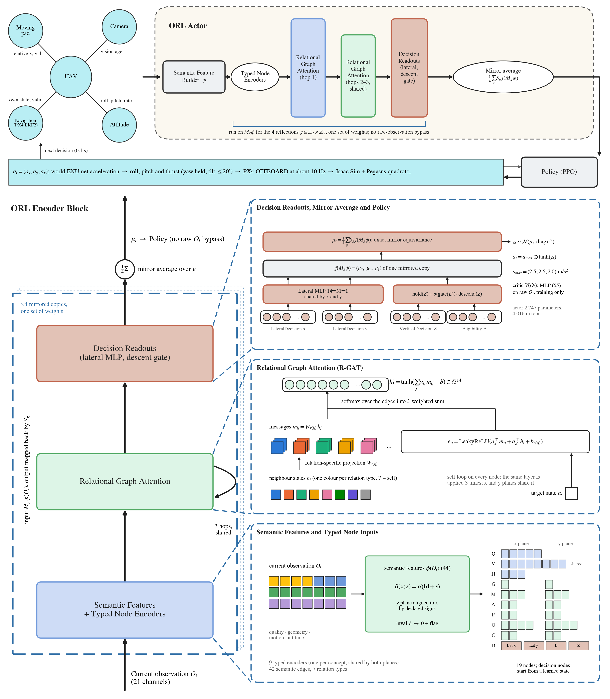
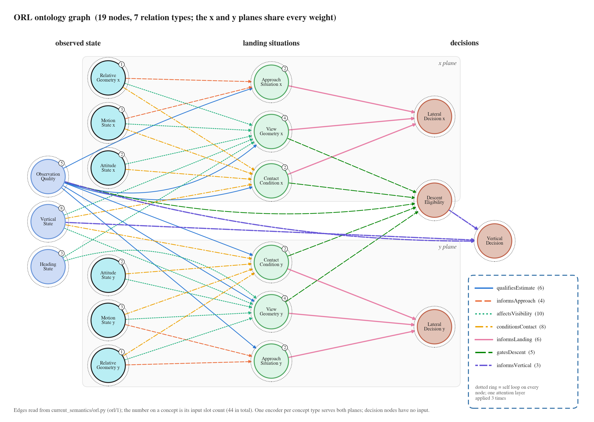
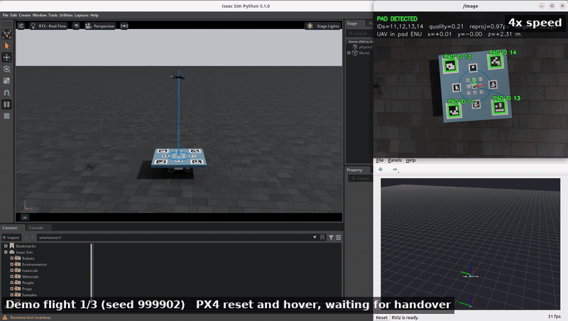
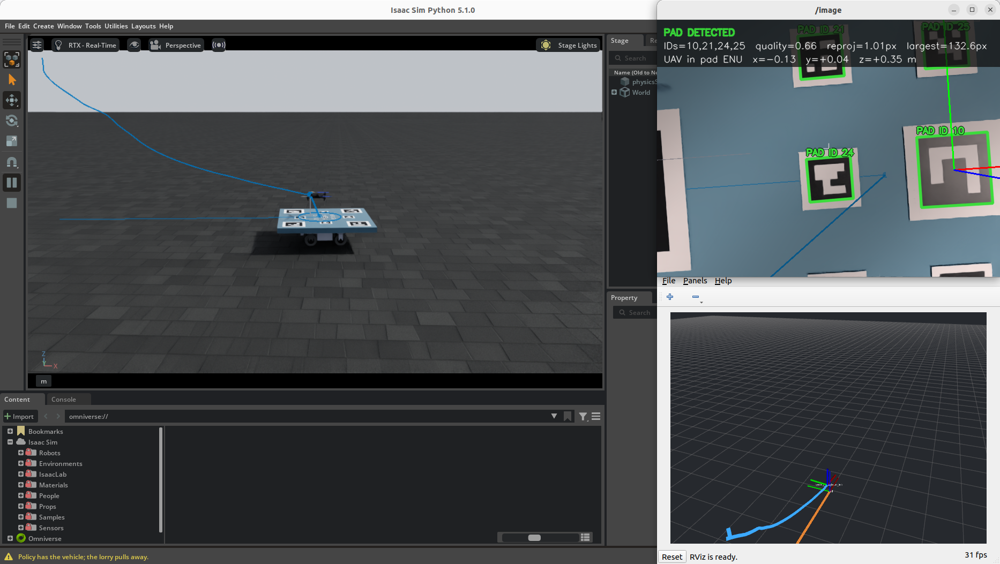
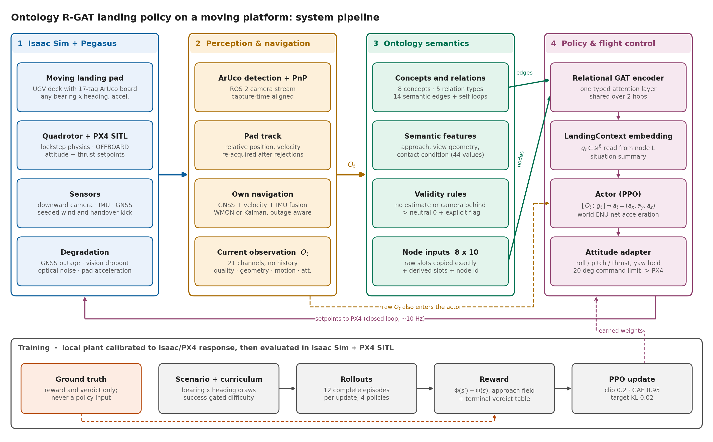
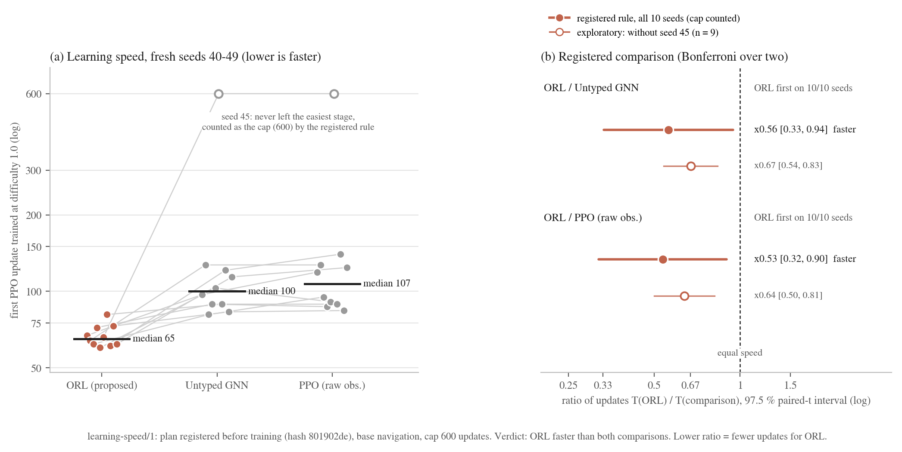
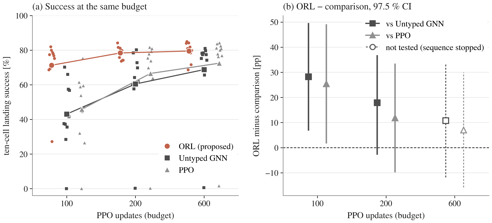

# 온톨로지 기반 관계 그래프 어텐션 강화학습을 이용한 이동 플랫폼 UAV 착륙

이동하는 지상 플랫폼(UGV) 위에 쿼드로터를 착륙시키는 강화학습 정책이다.
정책은 매 결정 시점의 현재 관측만 받아 월드 좌표계 3축 순가속도 `(a_x, a_y, a_z)`를 낸다.
현재 관측은 카메라 기반 패드 추정값과 기체의 항법 상태로 이루어진다.

제안 정책 **ORL(Ontology Reinforcement Learning)** 은 착륙 온톨로지를 정책의 *구조* 로 쓴다.
관측을 온톨로지 개념 노드로 나누고, 관계 그래프 어텐션망(R-GAT)이 선언된 관계를 따라서만 정보를 전달한다.
행동은 결정 노드에서만 읽는다. 원 관측이 그래프를 건너뛰어 행동으로 가는 경로는 없다.
CNN이 합성곱에서, LSTM이 게이트에서 귀납 편향을 얻듯이, ORL은 온톨로지 선언에서 네 가지 편향을 얻는다.

- **국소성:** 개념마다 자기 입력 슬롯만 인코딩하고, 정보는 선언된 관계로만 흐른다.
- **가중치 공유:** 3축 과제를 수평축마다 하나씩인 착륙 평면 두 개로 보고, x·y 평면이 인코더·관계 가중치·수평 판독을 공유한다.
- **거울 등변성:** 개념마다 두 거울 반사에 대한 부호를 선언하고, 네 반사에 대한 평균으로 정확한 등변성을 얻는다.
- **하강 게이트:** 접지 조건, 시야 기하, 관측 품질이 하강 적격성 노드에서 만나 수직 명령의 하강 항을 조절한다.

검증은 Isaac Sim + Pegasus + PX4 SITL + ROS 2 폐루프와, Isaac/PX4 응답에 맞춘 로컬 플랜트로 한다.
비교 정책은 파라미터 수, 보상, 학습 예산이 제안 정책과 같다.

> **현재 근거**
>
> - **학습 속도(확인됨):** 사전 등록한 확인 실험 `learning-speed/1`(새 학습 시드 10개)에서 ORL은 최고 난이도에 **중앙값 65 업데이트** 만에 도달했다.
>   Untyped GNN은 100, PPO는 107 업데이트가 걸렸고, ORL이 10개 시드 모두에서 먼저 도달했다.
>   등록된 규칙의 판정은 두 비교 모두 **"ORL이 더 빠름"** 이다(소요 비율 ×0.56, ×0.53; 97.5 % 구간 상한 0.94, 0.90). 자세한 내용은 3.4.
> - 이 지표는 개발 단계(학습 시드 5개)에서 결과를 본 뒤 고른 것이었고(ORL 평균 70, 비교 정책 107–109), 새 시드에서 재현됐다.
> - 착륙 성공률은 아직 확립되지 않았다. 로컬 10개 평가 셀 평균은 ORL 79.5 %, Semantic MLP 77.2 %, PPO 75.6 %이고, 등록된 주 비교(ORL − Semantic MLP)의 95 % 구간은 0을 포함한다.
> - Isaac Sim + PX4에서는 시연 비행만 했다(3.1의 영상, 6회 모두 착륙). 평가는 아직 하지 않았다.



*전체 구조: 제안 정책 ORL(왼쪽)과 비교 정책 PPO(오른쪽, `raw_ppo`).*
- **ORL:** 현재 관측 `O_t` → 의미 특징 44개와 개념별 노드 인코더 → 관계 그래프 어텐션(같은 층을 3홉) → 결정 판독 → 거울 평균 → 정책 머리
  - 보라색 화살표가 그래프의 출력 경로이다. 3홉 뒤 결정 노드 4개(수평 x·y, 수직 Z, 하강 적격성 E)의 상태 `h^(3)`(각 14차원)만 판독층으로 간다.
  - 그래프 전체를 요약한 벡터는 없고, 원 관측이 그래프를 건너뛰는 경로도 없다.
  - ①: 수평 x·y 상태가 x·y 공유 수평 MLP를 거쳐 `μ_x`, `μ_y`가 된다.
  - ②: Z·E 상태가 `hold(Z) + σ(gate(E))·descend(Z)`를 거쳐 `μ_z`가 된다.
  - 뒤에 겹친 상자는 같은 가중치로 도는 거울 복사본 4개이다.
- **PPO:** 원 관측 `O_t` → 은닉층 하나(110, tanh)의 MLP actor → 선형 출력 `μ_t`
- **아래 띠:** 두 정책이 같이 쓰는 부분이다. 차이는 actor뿐이다.
  - critic: 원 관측 MLP 21→55→1, 학습 때만 쓴다.
  - 가우시안 정책 머리와 행동 한계
  - PPO 설정, 보상, 커리큘럼, 시드
  - 파라미터는 ORL 4,016개, PPO 4,022개이다.
- PX4까지 이어지는 실행 흐름은 3.1의 시스템 파이프라인 그림에 있다.

---

## 1. 문제 설정

- **이동 플랫폼:** 패드의 조건은 다음과 같다.
  - 정책 인계 시점에 드론과 패드 사이의 방위(A)와 패드 진행 방향(B)은 전 방향(4개 구역씩)에서 뽑는다.
  - 패드는 가속 운동을 할 수 있다.
  - 패드에는 17개 태그로 된 ArUco 보드가 있다.
- **3축 가속도 제어:** 정책의 행동은 월드 ENU 좌표계의 순가속도이다.
  - 자세는 행동에서 유도되며, 롤·피치·추력으로 바뀌고 요는 고정한다. 정책이 따로 학습하지 않는다.
  - 2축(종·수직) 상대 운동 착륙 문제를 수평 2축 + 수직 1축으로 확장한 형태이다.
- **현재 관측만 사용:** 정책 입력은 현재 시점의 21채널 관측 `O_t`이다.
  - 이력, 적분항, 이전 행동, 교사 신호는 넣지 않는다.
  - 패드 추정이 없거나 오래되었다는 사실은 관측 안의 품질 채널(시야 나이, 항법 유효·나이)로 드러난다.
- **항법:** 자기 위치·속도는 기준 항법 상태를 그대로 쓴다(Isaac에서는 PX4 EKF2 출력). 별도의 항법 추정기는 쓰지 않는다.
- **참값은 보상과 판정에만 쓴다.** 시뮬레이터 참값은 정책, 가치함수, 그래프 입력 어디에도 들어가지 않는다.
- **착륙 판정:**
  - SUCCESS: 패드 위에서 접지하고, 접지 속도가 |v_z| ≤ 0.30 m/s, |v_xy| ≤ 0.35 m/s이며, 추력축 기울기가 21° 미만인 경우
  - UNSAFE_CONTACT: 접지했지만 속도 한계를 넘은 경우
  - SAFETY_ENVELOPE_VIOLATION: 비행 중이나 접지 시 기울기가 21°를 넘은 경우
  - MISSED_PAD_CONTACT: 패드 밖에 접지한 경우
  - TASK_TIMEOUT: 제한 시간을 넘긴 경우

  이 문서에서 **위험 판정**은 UNSAFE_CONTACT와 SAFETY_ENVELOPE_VIOLATION을 합한 것이다.

## 2. 제안 방법: ORL

### 2.1 착륙 온톨로지 그래프



3축 과제를 수평축마다 하나씩인 착륙 평면 두 개(x, y)와, 두 평면이 함께 쓰는 수직·품질·방위 상태로 나눈다.
노드는 19개, 관계 유형은 7개(자기 루프 제외)이다.

| 개념 | 노드 | 담는 내용 | 슬롯 |
|---|---|---|---:|
| ObservationQuality (Q) | 공유 | 시야 갱신 여부·시야 나이, 항법 유효·항법 나이, 카메라 전방 여부 | 5 |
| VerticalState (V) | 공유 | 상대 높이, 수직 속도, 접지 수직 속도·기울기·각속도, cos 롤·cos 피치, 접근 폐합률 | 8 |
| HeadingState (H) | 공유 | 요(sin, cos), 요 각속도 | 3 |
| RelativeGeometry (G) | 평면마다 | 그 축의 패드 대비 상대 위치 | 1 |
| MotionState (M) | 평면마다 | 그 축의 상대 속도, 패드 속도, 자기 속도 | 3 |
| AttitudeState (A) | 평면마다 | 그 축의 기울기 사인과 각속도 | 2 |
| ApproachSituation (P) | 평면마다 | 그 축의 접근 오차와 접근 속도 | 2 |
| ViewGeometry (O) | 평면마다 | 그 축의 패드 영상 좌표, 변화율, 양쪽 영상 경계까지의 여유 | 4 |
| ContactCondition (C) | 평면마다 | 그 축의 접지 기준 위치·속도 오차 | 2 |
| LateralDecision (Lat) | 평면마다 | 입력 없음. 그 축의 수평 명령을 읽는 결정 노드 | 0 |
| DescentEligibility (E) | 하나 | 입력 없음. 하강 게이트를 읽는 결정 노드 | 0 |
| VerticalDecision (Z) | 하나 | 입력 없음. 수직 명령을 읽는 결정 노드 | 0 |

슬롯 합은 44개(공유 16 + 평면당 14 × 2)이다. y 평면의 슬롯은 선언된 부호로 x 평면과 같은 물리 방향에 맞춘다.
예를 들어 카메라 y축은 기체 y축의 반대이므로 영상 좌표는 −η를, a_y는 −sin(롤)을 따른다.

| 관계 유형 | 간선 (평면마다) | 수 | 의미 |
|---|---|---:|---|
| `qualifiesEstimate` | Q → P, O, C | 6 | 관측 품질이 파생 상황의 신뢰도를 한정한다 |
| `informsApproach` | G, M → P | 4 | 상대 기하와 운동이 접근 상황을 정한다 |
| `affectsVisibility` | G, M, A, V, H → O | 10 | 위치·운동·자세·높이·방위가 패드의 화면 위치와 이탈 여유를 정한다 |
| `conditionsContact` | G, M, A, V → C | 8 | 위치·운동·자세·수직 상태가 접지 가능 조건을 정한다 |
| `informsLanding` | P, O, C → Lat | 6 | 세 착륙 상황이 그 축의 수평 결정을 이룬다 |
| `gatesDescent` | C, O → E, 그리고 Q → E | 5 | 접지 조건, 시야, 관측 품질이 하강 적격성에서 만난다 |
| `informsVertical` | V, Q, E → Z | 3 | 수직 상태, 품질, 적격성이 수직 결정을 이룬다 |

모든 노드에 자기 루프가 있어 간선은 61개이다. 그래프는 다음 성질을 갖도록 설계했고, 테스트로 확인한다.

- 각 평면의 수평 결정은 자기 평면 개념과 공유 개념을 **3홉 안에** 모두 읽는다.
- 각 평면의 수평 결정은 다른 평면의 개념을 홉 수와 관계없이 읽지 못한다.
- 관계 이름은 학습되는 가중치를 고르는 데만 쓴다. 규칙으로 실행되지 않는다.

### 2.2 의미 특징과 유효성 규칙

- 21채널 관측을 44개 의미 특징 φ(O_t)로 바꾼다. φ는 순수 함수이며, 특징마다 정해진 개념 슬롯에 들어간다.
- 원 관측 채널은 손대지 않고 그대로 복사한다.
- 파생 특징은 모두 하나의 유계 사상 `B(x; s) = x / (|x| + s)`를 거친다. 여기서 s는 물리 단위의 등록된 척도이다.
- 파생 특징의 예는 다음과 같다.
  - 접근 오차와 폐합률
  - 핀홀 투영으로 계산한 패드 영상 좌표 (ξ, η)와 그 변화율
  - 영상 경계까지의 여유
  - 접지 한계 대비 속도와 기울기
- **유효성 규칙:** 해당 조건이 성립할 때만 특징을 계산한다. 성립하지 않으면 특징은 중립값 0이고, 같은 벡터 안의 플래그가 그 이유를 알린다. 따라서 0이 정렬된 상태로 오인되지 않는다.
  - 패드 추정이 유효해야 하는 특징과, 카메라 앞쪽에 패드가 있어야 하는 특징이 있다.

### 2.3 ORL 인코더

노드 i의 입력 x_i(그 개념의 슬롯)는 다음 순서로 처리된다(노드 상태 14차원).

```
h_i^(0) = tanh(W_c(i) x_i + b_c(i))                  개념 유형 c마다 인코더 하나, x·y 평면이 공유
h_k^(0) = tanh(d_k)                                  결정 노드 Lat_x, Lat_y, E, Z: 학습되는 초기 상태
m_ij    = W_r(ij) h_j                                관계 유형마다 W_r 하나
e_ij    = LeakyReLU(a_sᵀ m_ij + a_dᵀ h_i + b_r(ij))
α_ij    = softmax_{j ∈ N(i)} e_ij                    노드 i로 들어오는 간선에 대해서만
h_i'    = tanh(Σ_j α_ij m_ij + b)                    같은 층을 3회 적용
```

- **개념별 인코더:** 개념 유형 9개마다 선형 인코더 하나이다. x 평면과 y 평면의 같은 개념은 같은 인코더를 쓴다.
- **관계별 변환:** 의미가 다른 메시지를 서로 다른 선형 사상으로 옮긴다. 관계 가중치도 두 평면이 공유한다.
- **어텐션:** 들어오는 메시지의 상대적 비중을 상태에 따라 정한다.
- **층 공유:** 세 홉이 같은 층을 쓴다. 홉 수는 표현력이 아니라 도달 범위를 정하며, 파라미터는 늘지 않는다.

### 2.4 결정 판독, 거울 등변성, 비행 제어

```
μ_x = MLP_lat(h_Lat_x^(3)),  μ_y = MLP_lat(h_Lat_y^(3))   같은 MLP(14 → 31 → 1, 출력 편향 없음)
μ_z = hold(h_Z^(3)) + σ(gate(h_E^(3))) · descend(h_Z^(3))
f(φ) = (μ_x, μ_y, μ_z)
μ_t = ¼ Σ_{g ∈ Z₂×Z₂} S_g f(M_g φ)                     네 거울 반사에 대한 평균
z_t ~ N(μ_t, diag σ²),  a_t = a_max ⊙ tanh(z_t),  a_max = (2.5, 2.5, 2.0) m/s²
```

- **거울 등변성:** M_g는 선언된 부호에 따라 φ를 반사하고, S_g는 행동의 수평 성분을 되돌린다. 거울에 비친 상태에는 정확히 거울에 비친 명령이 나온다.
  - 선언된 부호와 반사된 세계에서 다시 계산한 특징은 영상 항목을 빼고 정확히 같다. 영상 항목은 등록된 주점 때문에 |Δ| ≤ 4.2 × 10⁻³이다.
- **원 관측 우회 없음:** 행동의 세 성분은 모두 결정 노드에서만 읽는다.
- **Critic:** V_t = MLP(O_t). 모든 비교 정책이 같은 설계를 쓰며, 학습에만 쓰인다.
- **파라미터 예산:** Actor 2,747개, 전체 4,016개이다. 비교 정책은 4,008–4,022개이다.
- **PPO가 평가하는 행동과 환경이 받는 행동이 같다.** 감독기가 행동을 다시 쓰지 않는다.
- **비행 제어:** 순가속도를 롤·피치·추력으로 바꾸고 요를 유지한다. 명령 기울기는 20°로 제한한다.
  - 명령은 PX4 OFFBOARD로 전달된다. 결정 주기는 약 10 Hz이다.

### 2.5 학습


- **보상:**

  ```
  r_t = Φ(s_{t+1}) − Φ(s_t) − (0.3 + 0.5·mean(u_t²))Δt − 20 κ_t² Δt + R_term
  Φ(s) = −( 2‖(e, h)‖ + 4‖v − v_des(e, h, τ_vis)‖ )
  ```

  - **접근 속도장 v_des:**
    - 기본 동작: 수평으로 패드에 정렬한다. 반경 0.25 + 0.5h의 하강 원뿔 안에서만 하강하고, 접지 직전 하강 속도는 0.2 m/s이다.
    - 시야를 잃으면 탐색 높이 2.5 m까지 상승한다. 단, 높이 0.5 m 이하이면서 중심 0.75 m 이내인 마지막 구간은 예외이다.
  - 위치 퍼텐셜만 쓰면 가속도 행동은 두 번 적분된 뒤에야 보상에 반영된다. 속도 오차 퍼텐셜은 한 결정 주기 안에 반응하므로 신용 할당을 돕는다.
  - u_t = a_t / a_max이다. κ_t는 10° 이상의 기울기를 21° 한계로 정규화한 값이다.
  - R_term: SUCCESS +25, TASK_TIMEOUT −12, SAFE_ABORT −15, 위험·패드 이탈 접지 −40
- **PPO:**
  - 업데이트마다 완결 에피소드 12개를 모은다.
  - 클립 0.2, 8 에폭, GAE λ 0.95, 목표 KL 0.02
  - 할인은 실제 전이 시간으로 γ = exp(−Δt / 70 s)이다.
- **커리큘럼:** 난이도 0에서 시작한다. 최근 성공률이 50 %를 넘으면 0.1씩 올린다. 검증과 시험은 언제나 난이도 1이다.
- **학습 무작위화:** 학습 에피소드에만 넣는다.
  - 절반의 에피소드에 시야 차단(1–3 s)을 넣는다.
  - 인계 직후 감쇠하는 자기 속도 오차(수평 최대 1.5 m/s)를 넣는다.
- **학습 플랜트:** Isaac/PX4의 응답에 맞춰 보정한 로컬 플랜트에서 학습한다. 보정 대상은 자세 응답, 지연, 광학 검출 모델, 접지 높이이다.
  학습된 체크포인트는 수정 없이 Isaac Sim + PX4에서 평가한다.

## 3. 검증

### 3.1 시뮬레이션 환경



*실제 운용 환경에서의 ORL 시연 비행(4배속).*
- 왼쪽: Isaac Sim 5.1 GUI. 기체(Iris)가 정지한 트럭 위에서 PX4로 호버링하다가, 인계 순간 트럭이 출발한다. 그 뒤로는 ORL 정책이 따라가 착륙한다. 파란 선은 기체 궤적이다.
- 오른쪽 위: ROS 2 `image_view`로 본 하방 카메라. ArUco 검출 결과(태그 ID, 재투영 오차, 패드 기준 기체 위치)가 겹쳐 그려진다. 접지 직전에는 패드가 너무 가까워 검출되지 않는다.
- 오른쪽 아래: RViz2. 기체를 따라가는 시점에서 기체 궤적(파랑)과 패드 궤적(주황)을 그린다.
- 모델은 `learning-speed/1` 학습 시드 41의 ORL(`orl/1`)이다. 최고 난이도에 처음 도달한 64번째 업데이트에서 학습을 멈춘 모델이다. 시연 전용 시드로 결정론적으로 비행했다.
- 같은 모델로 두 번 띄운 스택에서 각각 3회씩, 6회 모두 SUCCESS였다. 첫 번째 스택에서는 RViz2가 뜨지 못했다. 영상은 두 번째 스택이다.
- 시연은 평가가 아니다. 시드 수가 적고, 성공률 주장에는 쓰지 않는다.
- 세 비행 전체 영상: [orl_isaac_px4_demo.mp4](docs/figures/orl_isaac_px4_demo.mp4) (51 s, 4배속).
  - GUI 렌더링 때문에 시뮬레이션이 실제 시간보다 약 3.8배 느리게 돌았다. 그래서 4배속이 대략 시뮬레이션 시간 기준의 실시간이다.



*같은 비행의 한 장면.*
- 기체가 움직이는 패드를 따라가며 내려가는 중이다. 카메라 추정으로 패드 위 0.35 m이다.
- 카메라가 태그 4개(ID 10, 21, 24, 25)를 검출하고 있다(quality 0.66, 재투영 오차 1.0 px).



| 항목 | 설정 |
|---|---|
| 시뮬레이터 | Isaac Sim 5.1.0 + Pegasus Simulator, lockstep 물리 |
| 기체 | Iris 쿼드로터, 하방 카메라. 에피소드마다 시드로 정한 외력·외란 토크와 인계 속도 교란이 있다 |
| 비행 제어기 | PX4 v1.14.3 SITL, OFFBOARD 자세·추력 설정값 |
| 미들웨어 | ROS 2 Humble (Isaac ROS 2 브리지, 카메라·상태 토픽) |
| 착륙 패드 | UGV 위 17-태그 ArUco 보드 (세 가지 크기) |
| 패드 인식 | ArUco 검출 + PnP, 촬영 시각 정렬, 반복 거부 후 추적 재획득 |
| 항법 | 기준 항법(PX4 EKF2 출력). 별도의 항법 추정기는 쓰지 않는다 |

#### 센서 사양

Isaac Sim 쪽 값은 배포 프로필 `config/spatial-isaac-system-v12.yaml`과 Pegasus 센서 기본값에서 가져왔다.
시뮬레이션 물리는 250 Hz(lockstep), 렌더링은 30 Hz, 정책 결정은 약 10 Hz(0.1 s)이다.

| 센서 | 모델 | 주요 사양 | 쓰이는 곳 |
|---|---|---|---|
| 하방 카메라 | 핀홀 RGB, 1/3인치 센서, 롤링 셔터 | 640 × 480 px, 수평 화각 90°(수직 73.7°), 초점거리 2.1 mm, 20 Hz 촬영(정책은 결정마다 약 1프레임 수신), 기체 아래 0.16 m에 수직 하방 장착, 촬영 거리 0.02–60 m | ArUco 검출 → 패드 상대 위치·속도 |
| 착륙 패드 표식 | ArUco `DICT_4X4_50` 17-태그 보드 | 모서리 0.26 m × 4, 중간 링 0.14 m × 4, 중앙 0.08 m × 1 + 0.05 m × 8. 최대 검출 거리 9 m, 재투영 오차 기준 3 px | 패드 자세 추정(PnP) |
| IMU | VectorNav VN-100 모델 | 시뮬레이션 갱신 250 Hz(실기 출력 800 Hz). 자이로: 범위 ±2000 °/s, 잡음 밀도 6.1 × 10⁻⁵ rad/s/√Hz, 바이어스 안정도 2.4 × 10⁻⁵ rad/s. 가속도계: 범위 ±16 g, 잡음 밀도 1.37 × 10⁻³ m/s²/√Hz, 바이어스 안정도 3.9 × 10⁻⁴ m/s². 16비트 포화 모델 | PX4 EKF2 입력 |
| GPS | Pegasus 기본 GPS | 갱신 250 Hz, 위치 잡음 밀도 2 × 10⁻⁴ m/√Hz(수평)·4 × 10⁻⁴(수직), 랜덤 워크 2.0/4.0 (m/s)/√Hz, 속도 잡음 밀도 0.2/0.4 (m/s)/√Hz, 상관 시간 60 s, 3D fix | PX4 EKF2 입력 |
| 기압계 | Pegasus 기본 기압계 | 250 Hz, 압력 잡음 1 Pa RMS | PX4 EKF2 입력 |
| 자력계 | Pegasus 기본 자력계 | 250 Hz, 잡음 밀도 0.4 × 10⁻³ gauss/√Hz, 랜덤 워크 6.4 × 10⁻⁶ gauss·√Hz | PX4 EKF2 입력 |

- 로컬 학습 플랜트의 카메라 모델도 같은 카메라와 보드를 쓴다.
  - 검출 조건: 태그 하나가 화면 안에 12 px 이상으로 온전히 투영될 때
  - 오류 모델: 꼭짓점 잡음 0.5 px, 프레임 누락 5 %, 영상 전달 지연 75 ms

### 3.2 비교 정책

모든 정책은 다음을 공유한다.

- 보상, 판정, PPO 설정, 커리큘럼, 학습 무작위화
- 학습 시드, 학습 예산(업데이트당 12 에피소드), 가치함수 설계, 평가 케이스

| 정책 | Actor 입력 | 제안 정책과의 차이 |
|---|---|---|
| **ORL (제안)** | φ(O_t)를 온톨로지 노드로만 읽음 | – |
| Untyped GNN | O_t + 같은 개념 그래프의 판독 | 관계 이름이 없고, 원 관측이 그래프를 건너뛴다 |
| PPO (raw obs.) | O_t (21채널) | 의미 특징과 그래프가 없다 |
| 참고: Semantic MLP | φ(O_t) (44개) | 입력은 같고 구조가 없다 |
| 참고: 기존 R-GAT | O_t + 관계 그래프 판독 g_t (8차원) | 원 관측이 그래프를 건너뛰어, 정책이 그래프를 무시할 수 있다 |

### 3.3 평가 조건

- **학습 속도:** 학습이 처음으로 최고 난이도(1.0)에서 이루어진 업데이트 번호. 낮을수록 같은 과제를 적은 경험으로 익힌 것이다.
- **같은 예산 착륙 성능:** 정확히 100, 200, 600 업데이트를 학습한 직후의 가중치를 선택 없이 그대로 평가한다. 점수는 아래 셀 10개의 평균 성공률이다.
- **로컬 평가 셀 10개:** 결정론적 평가이다. 개발 단계는 셀마다 학습 시드별 100 에피소드, `equal-budget/1`은 50 에피소드이다.

| 셀 | 분포 안 (ID) | 분포 밖 (OOD) |
|---|---|---|
| composition | 학습한 (A, B) 조합 | 제외한 조합 |
| motion | 기본 패드 운동 | 패드 가속 0.6–0.9 m/s² |
| dropout | 시야 차단 1–3 s | 시야 차단 3–4 s |
| noise | 기본 광학 잡음 | 광학 잡음 5배 |
| combined | 시야 차단 1–3 s | 가속 + 3–4 s 차단 + 잡음 5배 |

- **Isaac 폐루프:** ORL 체크포인트의 Isaac Sim + PX4 평가는 아직 하지 않았다. 3.1의 영상은 시연 비행이고 평가가 아니다.

### 3.4 결과

#### 학습 속도 (개발 단계, 기준 항법, 학습 시드 10–14)

최고 난이도로 처음 학습한 업데이트이다. 예산은 600 업데이트이고, 모든 모델이 그 안에 도달했다.

| 학습 시드 | **ORL** | 기존 R-GAT | Untyped GNN | PPO (raw obs.) |
|---|---:|---:|---:|---:|
| 10 | **66** | 88 | 97 | 123 |
| 11 | **62** | 89 | 93 | 97 |
| 12 | **81** | 117 | 141 | 103 |
| 13 | **77** | 147 | 100 | 96 |
| 14 | **65** | 104 | 106 | 122 |
| 평균 | **70** | 109 | 107 | 108 |
| ORL 소요 비율 (ORL이 먼저 도달한 시드) | – | ×0.65 (5/5) | ×0.66 (5/5) | ×0.65 (5/5) |

- 소요 비율은 시드별 비율의 기하평균이다.
- Semantic MLP는 평균 98 업데이트였고, ORL이 5개 시드 중 4개에서 먼저 도달했다.
- 이 표는 결과를 본 뒤 고른 지표이므로 탐색적이다. 아래 확인 실험이 이 지표를 미리 등록해 검정했고, 결과가 재현됐다.

#### 학습 속도 확인 실험 `learning-speed/1` (사전 등록, 판정: ORL이 더 빠름)

- **비교:** ORL vs Untyped GNN, ORL vs PPO
- **조건:** 기준 항법, 새 학습 시드 40–49(다른 실험이 쓴 시드와 겹치면 등록이 거부된다)
- **측정:** 모델마다 최고 난이도로 처음 학습한 업데이트에서 멈추고, 상한은 600이다. 상한까지 도달하지 못하면 600으로 둔다.
- **판정 규칙(학습 전에 해시로 고정):** 시드별 ln T(ORL) − ln T(비교)의 짝지은 t 구간을 비교마다 97.5 %(Bonferroni)로 구한다.
  - 상한이 0보다 작고 ORL 모델 중 미도달이 없으면 "ORL이 더 빠름"이다.
  - 하한이 0보다 크면 "더 느림", 그 밖은 "확립되지 않음"이다.
- 2026-11-20 12:30에 등록하고 학습을 시작해 18:50에 30개 모델이 끝났다. 판정 전에 등록 검사(plan hash `801902de…`)를 통과했다.



| 학습 시드 | 40 | 41 | 42 | 43 | 44 | 45 | 46 | 47 | 48 | 49 | 중앙값 |
|---|---:|---:|---:|---:|---:|---:|---:|---:|---:|---:|---:|
| **ORL** | **67** | **64** | **62** | **72** | **60** | **66** | **81** | **61** | **73** | **62** | **65** |
| Untyped GNN | 97 | 127 | 81 | 89 | 103 | 미도달 | 89 | 121 | 83 | 114 | 100 |
| PPO (raw obs.) | 119 | 127 | 95 | 87 | 91 | 미도달 | 89 | 140 | 84 | 124 | 107 |

| 비교 | 소요 비율 T(ORL)/T(비교) | 97.5 % 구간 | ORL이 먼저 도달 | 판정 |
|---|---:|---:|---:|---|
| ORL / Untyped GNN | ×0.56 | [0.33, 0.94] | 10/10 | **ORL이 더 빠름** |
| ORL / PPO (raw obs.) | ×0.53 | [0.32, 0.90] | 10/10 | **ORL이 더 빠름** |

- 소요 비율은 시드별 비율의 기하평균이다. 미도달은 등록 규칙대로 600으로 셌다.
- **시드 45:** Untyped GNN과 PPO는 600 업데이트 동안 가장 쉬운 단계(난이도 0)를 벗어나지 못했다. 같은 시드에서 ORL은 66번째 업데이트에 최고 난이도에 도달했다.
  - 이 시드가 평균 차이를 키운다. 시드 45를 뺀 9개 시드로 다시 구하면 ×0.67 [0.54, 0.83], ×0.64 [0.50, 0.81]이다.
  - 이 재계산은 등록 규칙 밖의 탐색적 확인이고, 판정은 바뀌지 않는다.
- ORL 모델 10개는 모두 상한 안에 도달했다. 부호 검정(p = 0.002)은 보고만 하고 판정에 쓰지 않는다.
- 이 실험이 보여 주는 것은 커리큘럼을 끝까지 올라가는 속도이다. 착륙 성능은 측정하지 않았다. 모델은 그 업데이트에서 학습을 멈췄고 평가하지 않았다.

#### 같은 예산 착륙 성능 `equal-budget/1` (사전 등록, 판정: 예산 100에서 ORL이 더 잘 착륙)

- **질문:** 학습 속도의 차이가 같은 학습 예산에서의 착륙 성능 차이로 이어지는가?
- **비교와 조건:** `learning-speed/1`과 같은 세 정책, 기준 항법, 새 학습 시드 50–59, 모델당 600 업데이트
- **측정:** 업데이트 100, 200, 600 직후의 가중치를 선택 없이 저장하고, 로컬 셀 10개를 셀당 50 에피소드씩 비행한다(새 환경 시드 70,000,000부터). 모델 30개, 평가 45,000 에피소드이다.
- **예산 선택(학습 전, 다른 시드로):** 100은 `learning-speed/1`에서 비교 정책이 최고 난이도에 도달한 중앙값, 200은 그 실험의 모든 모델이 도달한 뒤, 600은 개발 단계의 예산이다.
- **판정 규칙(학습 전에 해시로 고정):** 예산마다 시드별 점수 차이(ORL − 비교)의 짝지은 t 구간을 비교마다 97.5 %(Bonferroni)로 구한다.
  - 하한 > 0이면 "더 잘 착륙(better)", 상한 < 0이면 "더 못함", 그 밖은 "확립되지 않음"이다.
  - 예산은 100 → 200 → 600의 고정 순서로 검정한다. "확립되지 않음"이 나오면 그 뒤 예산은 판정하지 않고 보고만 한다.
- 2026-11-20 20:32에 등록하고 2026-11-21 11:18에 끝났다. 판정 전에 등록 검사(plan hash `2a64bff5…`)를 통과했다.



| 정책 | 예산 100 | 예산 200 | 예산 600 |
|---|---:|---:|---:|
| **ORL** | **71.3 %** | **78.4 %** | **79.5 %** |
| Untyped GNN | 43.1 % | 60.5 % | 68.8 % |
| PPO (raw obs.) | 45.9 % | 66.6 % | 72.5 % |
| 예산 시점에 이미 최고 난이도로 학습 중이던 모델 (ORL / Untyped / PPO) | 10 / 2 / 4 | 10 / 9 / 9 | 10 / 9 / 9 |

| ORL − 비교 | 예산 | 평균 | 97.5 % 구간 | ORL이 높은 시드 | 판정 |
|---|---:|---:|---:|---:|---|
| Untyped GNN | 100 | +28.2 pp | [+7.1, +49.4] | 9/10 | **더 잘 착륙** |
| | 200 | +17.9 pp | [−2.5, +38.4] | 9/10 | 확립되지 않음 (검정 종료) |
| | 600 | +10.7 pp | [−11.8, +33.3] | 7/10 | 판정 없음 (보고만) |
| PPO (raw obs.) | 100 | +25.4 pp | [+2.0, +48.9] | 9/10 | **더 잘 착륙** |
| | 200 | +11.8 pp | [−9.6, +33.2] | 7/10 | 확립되지 않음 (검정 종료) |
| | 600 | +7.0 pp | [−15.8, +29.9] | 6/10 | 판정 없음 (보고만) |

- **시드 54:** Untyped GNN과 PPO는 600 업데이트 동안 가장 쉬운 단계(난이도 0)를 벗어나지 못했다(성공률 0–2 %). 같은 시드의 ORL은 63번째 업데이트에 최고 난이도에 도달했다.
  - `learning-speed/1`의 시드 45와 같은 양상이다. 두 실험의 새 시드 20개 중 ORL은 20개, 비교 정책은 각각 18개에서 최고 난이도에 도달했다.
  - 시드 54를 빼고 다시 구하면(탐색적) 예산 100은 +22.5 pp [+5.9, +39.0], +19.4 pp [+0.0, +38.7]이다. 예산 600은 +2.6 pp [−4.3, +9.6], −1.4 pp [−5.8, +3.1]로 거의 같다.
- 최고 난이도 첫 도달은 ORL 중앙값 64.5, Untyped 103.5, PPO 102.5 업데이트였다. 10개 시드 모두에서 ORL이 먼저 도달해 `learning-speed/1`이 다시 재현됐다(이 실험의 판정 지표는 아니다).
- 셀별(예산 600)로는 ORL이 motion OOD를 뺀 9개 셀에서 가장 높다. motion OOD는 PPO 74 %, ORL 71 %이다. combined OOD는 세 정책 모두 5–9 %로 실패한다.
- 위험 판정 비율은 예산 100에서 ORL 18.6 %, Untyped 23.0 %, PPO 24.5 %이고, 예산 600에서는 17.6–18.8 %로 비슷하다.

#### 로컬 평가 10셀 (개발 단계, 기준 항법, 학습 시드 10–14)

| 셀 | **ORL** | 기존 R-GAT | Semantic MLP | PPO (raw obs.) | Untyped GNN |
|---|---:|---:|---:|---:|---:|
| composition ID | **98.4 %** | 94.4 % | 92.2 % | 88.6 % | 91.0 % |
| composition OOD | **98.6 %** | 95.8 % | 94.0 % | 91.8 % | 93.4 % |
| motion ID | **98.2 %** | 95.6 % | 94.0 % | 91.0 % | 90.8 % |
| motion OOD | 69.6 % | 75.4 % | 72.4 % | **76.2 %** | 74.0 % |
| dropout ID | 88.0 % | **89.6 %** | 89.0 % | 85.2 % | 83.4 % |
| dropout OOD | 65.0 % | 69.2 % | 70.8 % | 70.2 % | **71.4 %** |
| noise ID | **99.6 %** | 95.6 % | 94.0 % | 90.4 % | 90.4 % |
| noise OOD | **84.2 %** | 73.8 % | 71.4 % | 65.8 % | 67.6 % |
| combined ID | 87.4 % | **90.6 %** | 87.8 % | 88.6 % | 87.6 % |
| combined OOD | 5.6 % | 5.8 % | 6.8 % | **8.2 %** | 6.6 % |
| **10셀 평균** | **79.5 %** | 78.6 % | 77.2 % | 75.6 % | 75.6 % |

학습 시드별로 짝지은 10셀 평균의 차이(95 % 구간)는 다음과 같다.

| ORL − 비교 정책 | 평균 | 95 % 구간 | 비고 |
|---|---:|---:|---|
| Semantic MLP | +2.2 pp | [−5.9, +10.4] | 사전 등록한 주 비교. 확립되지 않음 |
| PPO (raw obs.) | +3.9 pp | [−0.0, +7.7] | 부차 비교 |
| Untyped GNN | +3.8 pp | [+0.2, +7.5] | 부차 비교 |
| 기존 R-GAT | +0.9 pp | [−5.4, +7.2] | 부차 비교 |

- **패드가 계속 보이는 셀**(composition, motion ID, noise): ORL이 모든 정책 중 가장 높다. Semantic MLP와의 시드별 차이 25개 중 24개가 양수이고 나머지 1개는 0이다.
- **패드를 잃는 셀**(dropout, motion OOD, combined): ORL은 같거나 낮다. 시드 13·14에서 크게 진다.
- 분포 밖 셀(OOD 4개 + composition OOD, 5개 시드 합)의 위험 판정은 기록된 정책 중 ORL이 가장 적다.
  - ORL 139건(UNSAFE_CONTACT 26 + 기울기 한계 위반 113), 기존 R-GAT 165건, Semantic MLP 210건, PPO 346건이다.
  - 대신 패드 밖 접지는 ORL 627건으로 Semantic MLP 584건, PPO 470건보다 많다.
- **원 결과 파일:** 개발 단계 ORL(`orl/1`)의 모델과 평가 기록, Semantic MLP 모델은 2026-11-20 결과 정리 때 지워졌다(보관본에도 없다).
  - ORL 열의 수치는 진행 기록 20절에 남은 값이다.
  - Semantic MLP의 평가 요약은 `development.json`에 남아 있다.
  - 기존 R-GAT, Untyped GNN, PPO의 모델과 평가 기록은 남아 있다.

#### 해석 범위

- 착륙 성공률의 우위는 **확립되지 않았다.** 학습 시드 5개에서 사전 등록한 주 비교의 구간이 0을 포함한다. "같다"가 아니라 "가려지지 않았다"는 뜻이다.
- 학습 속도의 차이는 이 연구에서 정책 간에 처음으로 일관되게 보인 차이다. 사전 등록한 `learning-speed/1`에서 새 시드 10개로 재현됐다.
  - 측정한 것은 커리큘럼을 끝까지 올라가는 데 필요한 업데이트 수이다. 같은 예산에서 더 잘 착륙한다는 뜻은 아니다.
  - 비교 정책은 Untyped GNN과 PPO이다. 기존 R-GAT와 Semantic MLP는 이 확인 실험에 넣지 않았다.
- 네 편향을 함께 넣었으므로 각각의 기여는 분리되지 않았다.
- `orl/1`의 학습된 하강 게이트는 학습 후 모델마다 거의 상수였다(표준편차 ≤ 0.027). 따라서 이 결과는 실제로는 국소성, 가중치 공유, 거울 등변성 세 가지의 효과이다.
- 셀은 사후에 나누어 읽었다. 패드를 잃는 셀에서 지는 원인은 진단 중이다.
- 결과는 모두 로컬 플랜트에서 얻었다. Isaac 평가는 아직 없다. Isaac에서는 시연 비행 6회(모두 착륙)만 했다.
- 이전 단계에서 기존 R-GAT 정책을 항법 열화 조건(GNSS 결측, CA-KF와 Kinematic WLS 추정기)으로 평가한 실험은 그 코드·결과·문서와 함께 `archive/non_orl_20261120.tar.zst`에 보관했다. 그 결과는 이 연구의 주장에 쓰지 않는다.

## 4. 기여

본 연구의 **제안 방법**은 다음과 같다.

- 착륙 온톨로지 정의(공유 상태, 평면별 개념, 결정 노드)
- 온톨로지를 정책 구조로 쓰는 ORL: 국소성, 평면 가중치 공유, 거울 등변성, 하강 게이트
- PPO 정책 기반 3축 자율 착륙

다음은 **실험 환경을 이루는 구성 요소**로, 본 연구의 기여로 주장하지 않는다.

- Isaac Sim과 PX4 SITL, PX4 EKF2 항법
- ArUco 기반 상대 상태 추정
- 시야 차단, 광학 잡음, 패드 가속 모델

1. **착륙 상황의 온톨로지 구조화**
   - 관측 품질, 상대 기하·운동, 시야 기하, 접지 조건을 명시적인 개념과 관계로 정의했다.
   - 3축 과제를 수평축마다 하나씩인 착륙 평면 두 개와 공유 상태로 나누었다.
   - 모든 특징은 현재 관측의 순수 함수이며, 유효성 규칙으로 결측을 명시적으로 표현한다.
2. **온톨로지를 정책의 구조로 쓰는 강화학습(ORL)**
   - 원 관측 우회를 없애, 행동이 선언된 관계를 따라서만 관측에 의존하게 했다.
   - 두 평면이 인코더·관계 가중치·판독을 공유하고, 선언된 부호로 정확한 거울 등변성을 갖는다.
   - 파라미터 예산은 비교 정책과 같다(4,016개).
3. **학습 효율**
   - 사전 등록한 확인 실험(새 학습 시드 10개)에서 최고 난이도 도달에 필요한 업데이트가 Untyped GNN의 0.56배, PPO의 0.53배였다. 두 비교 모두 등록된 규칙으로 "더 빠름"이다(10/10 시드).
   - 개발 단계(시드 5개)에서는 약 0.65배였다.
4. **3축 가속도 제어로의 확장**
   - 2D 상대 운동 기반 착륙 문제를 월드 3축 순가속도 제어로 확장했다. 자세는 행동에서 유도한다.
   - 이동 플랫폼의 전 방향 접근, 패드 가속, 시야 차단, 광학 잡음 조건에서 평가할 수 있다.

**향후 과제**

- ORL 체크포인트의 Isaac Sim + PX4 폐루프 평가(현재는 시연 비행만 있다)
- 같은 학습 예산에서의 착륙 성능 비교(학습 속도 차이가 성능 차이로 이어지는지)
- 패드를 잃는 셀의 실패 원인 진단과 편향별 제거 실험
- 학습 시드를 늘린 착륙 성공률 확인 실험

## 5. 실행

모든 명령은 저장소 루트에서 실행한다. Isaac을 쓰는 단계는 `--allow-isaac`를 명시해야만 비행한다.

```bash
C=$PWD/Ontology_RGAT_UAV_RL_ISAAC_PX4/config/current_semantics/spatial_view_contact_v1.yaml   # 기준 항법
P=$PWD/Ontology_RGAT_UAV_RL_ISAAC_PX4/config/current_semantics

./run.sh current-semantics-3d --config $C --stage audit                   # 관측·특징·그래프 계약 점검
./run.sh current-semantics-3d --config $C --stage orl-learnability \
    --plan $P/orl_development_v1.yaml                                     # ORL(orl/1) 학습 가능성 파일럿

./run.sh current-semantics-3d --config $C --stage register-speed --plan $P/learning_speed_v1.yaml   # 확인 실험 등록
./run.sh current-semantics-3d --config $C --stage speed --plan $P/learning_speed_v1.yaml            # 학습 (여러 프로세스가 나눠 맡음)
./run.sh current-semantics-3d --config $C --stage speed-report --plan $P/learning_speed_v1.yaml     # 판정

./run.sh current-semantics-3d --stage monitor          # 읽기 전용 진행 현황 페이지 (http://127.0.0.1:8780/)
```

그림은 다음 명령으로 다시 만든다. 구조 그림은 코드(`orl.py`, `reward.py`)에서 직접 읽는다.

```bash
python3 Ontology_RGAT_UAV_RL_ISAAC_PX4/tools/make_doc_figures.py all      # overall, architecture, graph, field, speed
python3 Ontology_RGAT_UAV_RL_ISAAC_PX4/tools/make_doc_figures.py speed    # 하나만 (speed는 learning_speed.json에서)
python3 Ontology_RGAT_UAV_RL_ISAAC_PX4/tools/make_doc_figures.py all --formats tif,eps,pdf --out OUT   # IJCAS 투고용
```

- 그림은 IJCAS 지면의 두 단 전체 폭(168 mm)에 맞췄다. 그 크기에서 가장 작은 글자가 7 pt이다.
- 제목과 설명 문장은 그림 안에 넣지 않고 캡션으로 쓴다.
- 자세한 규칙은 [docs/figures/README.md](docs/figures/README.md)에 있다.

시연 영상은 GUI가 있는 X 화면에서 다음 명령으로 찍는다. Isaac 비행이므로 사용자 승인과 `--allow-isaac`가 필요하다.

```bash
cd Ontology_RGAT_UAV_RL_ISAAC_PX4
python3 tools/isaac_demo_capture.py capture OUT results/.../learning_speed/seed41/orl_ppo_eb68eb947a6a49a2/final.pt --allow-isaac
python3 tools/isaac_demo_capture.py media OUT ../docs/figures --still OUT/still_999902_048.png
```

## 6. 저장소 구조

| 경로 | 내용 |
|---|---|
| `Ontology_RGAT_UAV_RL_ISAAC_PX4/python/ontology_rgat/current_semantics/` | 제안 방법 |
| ├ `observation.py`, `features.py` | 21채널 관측, 44개 의미 특징과 유효성 규칙 |
| ├ `orl.py` | ORL: 개념·평면·결정 노드, 관계, 거울 부호, 인코더와 판독 |
| ├ `graph.py`, `models.py` | 비교 정책의 그래프와 actor-critic, 공통 관계 어텐션 층 |
| ├ `reward.py`, `ppo.py` | 접근 속도장 퍼텐셜 보상, PPO |
| ├ `backend.py`, `scenario.py` | 로컬/Isaac 백엔드, 시나리오 추출 |
| └ `speed.py`, `development.py`, `orl_development.py` | 학습 속도 확인 실험, 개발 단계, ORL 개발 비교 |
| `Ontology_RGAT_UAV_RL_ISAAC_PX4/python/ontology_rgat/spatial/`, `live_stack.py` | 3축 플랜트와 판정, Isaac/PX4 연동, 소유한 비행 스택 |
| `Ontology_RGAT_UAV_RL_ISAAC_PX4/isaac_sim/` | Isaac Sim 착륙 월드, 패드 운동, 센서, 외란 |
| `Ontology_RGAT_UAV_RL_ISAAC_PX4/config/current_semantics/` | 과제·관측·모델·학습·평가 설정 |
| `Ontology_RGAT_UAV_RL_ISAAC_PX4/tests/current_semantics/` | 단위 테스트 |
| `Ontology_RGAT_UAV_RL_ISAAC_PX4/tools/make_doc_figures.py` | 이 문서의 그림 생성 |
| `Ontology_RGAT_UAV_RL_ISAAC_PX4/tools/isaac_demo_capture.py`, `demo_tf_relay.py` | Isaac Sim + PX4 시연 비행의 화면 녹화와 영상·그림 생성 |
| `docs/figures/` | 그림과 그 설명 ([docs/figures/README.md](docs/figures/README.md)) |
| `archive/` (git 제외) | ORL이 쓰지 않는 경로의 압축 보관본 (`non_orl_20261120.tar.zst`, 목록은 안의 `MANIFEST.md`) |
