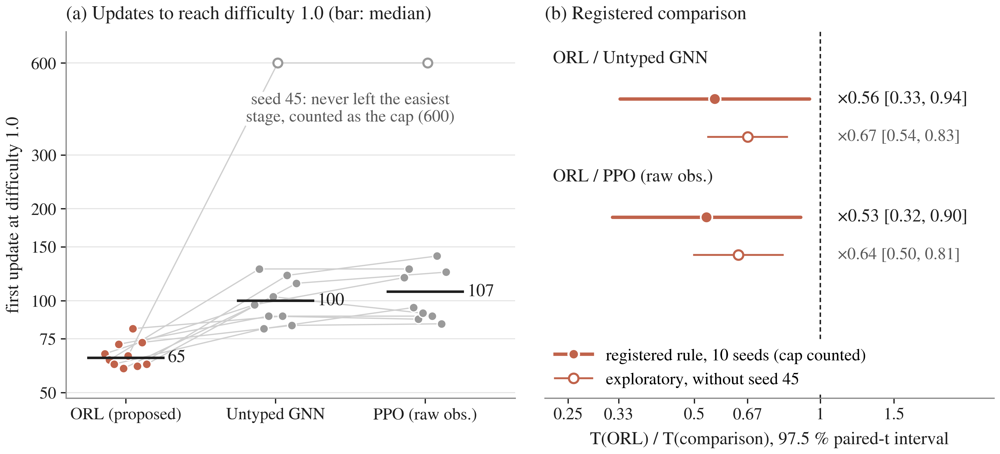
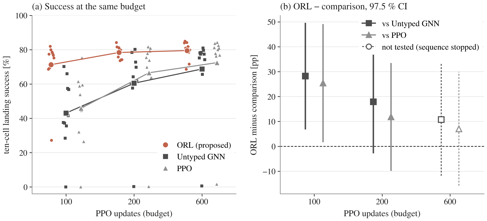
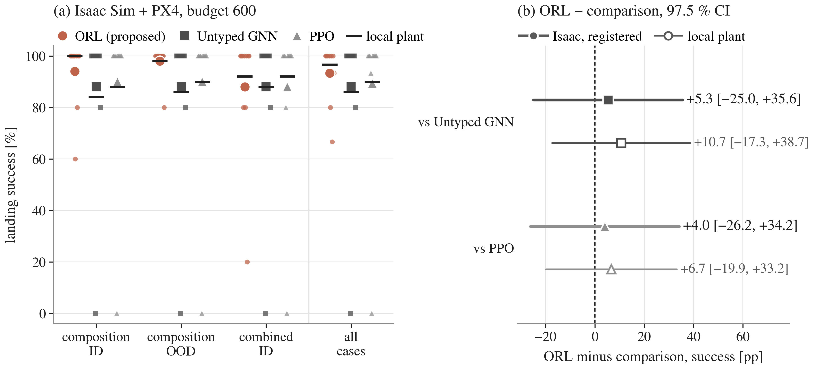
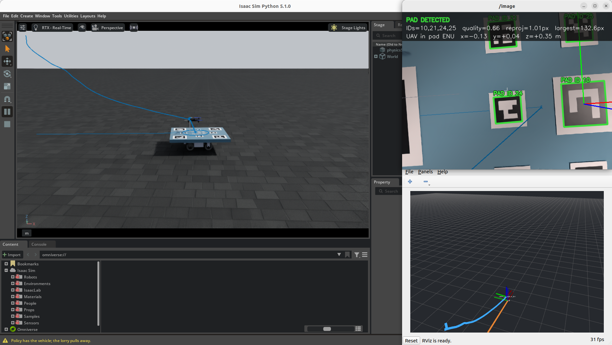

# 그림 모음

제안 정책 ORL(온톨로지를 정책 구조로 쓰는 R-GAT, `orl/1`)의 구조, 학습 신호, 검증 결과를 보여 주는 그림과,
실제 운용 환경(Isaac Sim + PX4 SITL + ROS 2)에서 찍은 시연 영상이다.

- 형식: IJCAS(International Journal of Control, Automation, and Systems) 지면에 맞춘다.
  - 지면은 2단(단 폭 80 mm, 간격 8 mm)이다. 구조·결과 그림은 모두 두 단 전체 폭인 168 mm로 넣는 것을 기준으로 그렸다.
  - 구조 그림: 그 크기로 인쇄했을 때 가장 작은 글자는 7 pt, 본문 글자는 8 pt, 제목은 9.5 pt이다(본문 Times New Roman 10 pt에 맞춤).
  - 결과 그래프(5–7절): Springer 그림 지침(최종 크기에서 글자 8–12 pt)에 맞춰 눈금 8 pt, 축 이름 8.5 pt, 패널 제목 9 pt이다.
  - 캡션은 그림 아래에 따로 쓰므로 그림 안에는 제목이나 설명 문장을 넣지 않는다.
  - PNG는 168 mm 폭에서 600 dpi이고, SVG에는 인쇄 크기(mm)를 적었다.
  - 저장할 때 인쇄 크기의 글자 크기, 글자끼리의 겹침, 상자 밖으로 넘친 글자, 그림 가장자리에서 잘린 글자를 자동으로 검사한다.
  - 흰 배경, 영문, 세리프 글꼴(Times 계열)이다. 관계 유형은 색과 선 모양을 함께 써서 흑백 인쇄에서도 구분된다.
- 다이어그램: 코드에서 직접 읽어 그렸다. 노드·간선·슬롯 수·파라미터 수는 `current_semantics/orl.py`(`orl/1`)에서 읽는다.
- 색 규칙:
  - 블록: 단계마다 파스텔 채움에 같은 색의 진한 테두리. 묶음은 파란 점선 상자로, 상세 패널은 점선으로 본 블록에 잇는다.
  - 결과 그림: 제안 정책만 강조색, 나머지 정책은 회색
  - 관계 유형 일곱 가지: 색맹 안전성을 검사한 범주형 팔레트(7칸)에 선 모양을 함께 써서 구분한다.

## 1. 전체 아키텍처: ORL과 PPO


제안 정책 ORL(왼쪽)과 비교 정책 PPO(오른쪽, `raw_ppo`)를 같은 높이의 단계끼리 맞춰 나란히 그렸다.

- **ORL 왼쪽 열:** 현재 관측 `O_t` → 의미 특징과 개념별 노드 인코더 → 관계 그래프 어텐션(같은 층을 3홉) → 결정 판독 → 거울 평균 → 정책 머리
  - 뒤의 겹친 상자는 같은 가중치로 도는 거울 복사본 4개이다.
  - 같은 망을 네 가지 거울 반사 M_g φ에 돌리고, 출력을 S_g로 되돌려 평균한다(정확한 거울 등변성).
- **ORL 오른쪽 상세 패널**(아래부터)
  - 의미 특징 44개와 개념별 노드 입력. x·y 평면이 같은 인코더를 쓰고, y 평면은 선언된 부호로 x에 맞춘다.
  - 관계별 변환 W_r(관계 7개 + 자기 루프), 어텐션 점수, 들어오는 간선에 대한 softmax
  - 결정 판독, 그리고 거울 평균
- **그래프 출력 경로(보라색)**
  - 3홉 뒤 19개 노드 가운데 결정 노드 4개(수평 x·y, 수직 Z, 하강 적격성 E)의 상태 `h^(3)`(각 14차원)만 판독층으로 간다.
  - 그래프 전체를 요약한 벡터는 없다. 원 관측이 그래프를 건너뛰어 actor로 가는 경로도 없다.
  - ①: 수평 x·y 상태가 x·y 공유 수평 MLP(14→31→1)를 거쳐 `μ_x`, `μ_y`가 된다.
  - ②: 수직 Z와 적격성 E 상태가 `hold(Z) + σ(gate(E))·descend(Z)`를 거쳐 `μ_z`가 된다.
- **PPO:** 원 관측 21채널 → 은닉층 하나(110, tanh)의 MLP actor → 선형 출력 `μ_t`
  - 의미 특징, 그래프, 거울 대칭, 하강 게이트가 없다.
  - actor 파라미터는 2,753개이다.
- **아래 띠:** 두 정책이 같이 쓰는 부분이다. 두 정책의 차이는 actor뿐이다.
  - critic: 원 관측 MLP 21→55→1, 학습 때만 쓴다.
  - 하나로 학습되는 log σ, 가우시안 정책 머리와 `a_max ⊙ tanh(z_t)` 행동 한계
  - PPO 설정, 보상, 커리큘럼, 시드
  - 전체 파라미터는 ORL 4,016개, PPO 4,022개이다.
- PX4 OFFBOARD까지 이어지는 실행 흐름은 2절 시스템 파이프라인 그림에 있다.

## 2. 시스템 파이프라인


Isaac Sim + Pegasus의 이동 패드와 PX4 SITL 쿼드로터에서 정책까지 이어지는 흐름은 다음과 같다.

1. ArUco 검출, 패드 추적, PX4 EKF2 자기 상태가 21채널 현재 관측 `O_t`를 만든다. 별도 항법 추정기는 쓰지 않는다.
2. 온톨로지 단계가 44개 의미 특징과 19개 노드의 입력을 만든다.
3. ORL 인코더, 결정 판독, 거울 평균이 3축 순가속도를 정한다.
4. 자세 변환기가 이를 PX4 설정값으로 바꾼다.

아래 띠는 오프라인 학습 흐름이다. 참값은 보상과 판정에만 들어가고, 원 관측 `O_t`는 critic에만 들어간다.

## 3. 온톨로지 그래프


노드, 간선, 관계 유형은 `current_semantics/orl.py`(`orl/1`)에서 그대로 읽었다.

- 타원 = 노드 19개
  - 공유 상태 개념 3개(관측 품질, 수직 상태, 방위)
  - 평면마다 개념 6개(x 평면 위, 거울상인 y 평면 아래)
  - 결정 노드 4개(수평 결정 x·y, 하강 적격성, 수직 결정)
- 타원 오른쪽 위의 숫자 = 그 개념의 입력 슬롯 수(합 44). 결정 노드는 입력이 없고 학습되는 초기 상태에서 시작한다.
- 점선 고리 = 자기 루프. 같은 어텐션 층을 3번 적용한다.
- 두 평면은 인코더와 관계 가중치를 모두 공유한다.

## 4. 시나리오와 접근 속도장


- (a) 정책 인계 시점의 시나리오 추출. 패드 방위 A와 패드 진행 방향 B는 4개 구역씩이고, 16개 조합 중 4개는 시험용으로 학습에서 뺀다.
- (b), (c) 보상 퍼텐셜이 요구하는 드론−패드 상대 속도 `v_des`. `current_semantics/reward.py: desired_velocity`를 격자에서 직접 계산했다.
  - 이 속도장은 보상만 만든다. 정책 입력에는 없다.

## 5. 학습 속도 확인 실험 `learning-speed/1`



- 판정 파일 `results/current_semantics_3d/spatial_current_semantics_v1/learning_speed/learning_speed.json`에서 그렸다.
- (a) 새 학습 시드 40–49에서 처음으로 최고 난이도(1.0)로 학습한 업데이트. 로그 축이고, 같은 시드는 회색 선으로 잇는다.
  - 굵은 가로선은 중앙값이다.
  - 빈 원은 상한 600 안에 도달하지 못한 모델이다(시드 45의 Untyped GNN과 PPO). 등록 규칙대로 600으로 센다.
- (b) 비교마다 T(ORL)/T(비교)의 기하평균과 97.5 % 짝지은 t 구간(Bonferroni)이다. 1보다 작으면 ORL이 업데이트를 덜 썼다는 뜻이다.
  - 채운 원은 등록된 판정이다. 두 구간 모두 1보다 작아 "ORL이 더 빠름"이다.
  - 빈 원은 시드 45를 뺀 탐색적 재계산이다. 판정에는 쓰지 않는다.

## 6. 같은 예산 착륙 성능 `equal-budget/1`



- 판정 파일 `results/current_semantics_3d/spatial_current_semantics_v1/equal_budget/equal_budget.json`에서 그렸다.
- (a) 학습 시드 50–59의 모델을 정확히 100, 200, 600 업데이트 학습한 직후의 가중치로 평가한 셀 10개 평균 성공률이다. 작은 점은 시드, 큰 점과 선은 평균이다.
  - 0 % 근처의 회색 점은 시드 54의 Untyped GNN과 PPO이다. 600 업데이트 동안 가장 쉬운 단계를 벗어나지 못했다.
- (b) 예산마다 시드별 차이(ORL − 비교)의 평균과 97.5 % 짝지은 t 구간(Bonferroni)이다.
  - 채운 기호는 등록된 순서 검정에서 판정한 예산이다. 예산 100은 두 비교 모두 구간이 0보다 커서 "더 잘 착륙"이다.
  - 예산 200에서 구간이 0을 포함해 순서 검정이 멈췄다. 빈 기호(예산 600)는 판정 없이 보고만 한다.

## 7. Isaac Sim + PX4 평가 `isaac-equal-budget/1`



- 판정 파일 `results/current_semantics_3d/spatial_current_semantics_v1/isaac_equal_budget/isaac_equal_budget.json`에서 그렸다. 로컬 기준은 같은 폴더의 `local_reference.jsonl`이다.
- (a) 예산 600 모델 30개의 Isaac Sim + PX4 SITL 착륙 성공률이다. 조건마다 새 환경 5개이고, 맨 오른쪽은 15사례 전체이다.
  - 작은 점은 모델(학습 시드), 큰 점은 정책 평균이다.
  - 검은 가로선은 같은 사례를 로컬 플랜트로 비행한 평균이다.
  - 0 %의 회색 점은 시드 54의 Untyped GNN과 PPO이다. 로컬에서 학습하지 못한 모델이다.
- (b) 시드별 차이(ORL − 비교)의 평균과 97.5 % 짝지은 t 구간(Bonferroni)이다.
  - 채운 기호가 등록된 Isaac 판정이다. 두 구간 모두 0을 포함해 "확립되지 않음"이다.
  - 빈 기호는 같은 사례의 로컬 결과이다. 보고만 하고 판정에는 쓰지 않는다.

## 8. 실제 운용 환경 시연




- 화면 구성
  - 왼쪽: Isaac Sim 5.1 GUI
  - 오른쪽 위: ROS 2 `image_view`로 본 하방 카메라의 ArUco 검출 화면(`/landing_uav0/perception/landing_camera/annotated`)
  - 오른쪽 아래: RViz2. 기체를 따라가는 시점에서 기체와 패드의 궤적을 그린다.
- 비행
  - 모델은 `learning-speed/1` 시드 41의 ORL(`orl/1`) `final.pt`이다. 최고 난이도에 처음 도달한 업데이트에서 학습을 멈춘 모델이다.
  - 시연 전용 시드 999902–999904로 결정론적으로 비행했다. 두 번 띄운 스택에서 6회 모두 SUCCESS였다.
- 파일
  - GIF: 첫 비행, 4배속
  - [orl_isaac_px4_demo.mp4](orl_isaac_px4_demo.mp4): 세 비행 전체, 4배속, 51 s. 화면 아래에 비행 단계(PX4 호버, 정책 비행, 결과)를 적었다.
  - PNG: 첫 비행의 한 장면
- RViz의 궤적 선은 비행 사이의 리셋 이동까지 이어 그린다.
- 4배속이면 대략 시뮬레이션 시간 기준의 실시간이다. GUI 렌더링 때문에 시뮬레이션이 실제보다 약 3.8배 느리게 돌았다.
- 시연은 평가가 아니다. 성공률 주장에는 쓰지 않는다.
- 논문에 넣을 때: 사진(1866 × 1053 px)은 화면 캡처라 그 안의 GUI 글자 크기는 바꿀 수 없다.
  - 168 mm 폭이면 282 dpi로, IJCAS의 컬러 그림 기준(300 dpi 이상)에 조금 못 미친다.
  - 158 mm 이하 폭으로 넣으면 기준을 넘는다.

## 다시 만들기

```bash
python3 Ontology_RGAT_UAV_RL_ISAAC_PX4/tools/make_doc_figures.py all       # 모든 그림
python3 Ontology_RGAT_UAV_RL_ISAAC_PX4/tools/make_doc_figures.py overall   # 하나만 (architecture, graph, field, speed, budget도 같은 방식)
python3 Ontology_RGAT_UAV_RL_ISAAC_PX4/tools/make_doc_figures.py all --formats tif,eps,pdf --out OUT   # 투고용 파일
```

- IJCAS가 권하는 형식은 TIF, EPS, JPG이다.
- `--formats`로 600 dpi TIF(LZW 압축), EPS, PDF를 만든다. 이 파일들은 저장소에 두지 않는다.
- PDF와 EPS에는 글꼴이 들어간다.

시연 영상과 사진은 `tools/isaac_demo_capture.py`로 만든다.

- `capture`
  - Isaac Sim GUI, `image_view`, RViz2를 한 화면에 배치하고 비행 동안 화면 전체를 녹화한다.
  - 비행마다 리셋·인계·결정·종료 시각을 `timeline.json`에 남긴다.
  - Isaac 비행이므로 `--allow-isaac`가 필요하다.
- `media`
  - 녹화에서 세 창 영역만 잘라 이 폴더의 GIF, MP4, PNG를 만든다.
  - 전체 화면 녹화는 다른 창이 찍힐 수 있으므로 올리지 않는다.

---

Copyright © 2026 Jun Suk Kim (김준석). 관리자: Jun Suk Kim (김준석) <junsuk55944587@gmail.com>. Apache License 2.0 ([LICENSE](../../LICENSE)).
