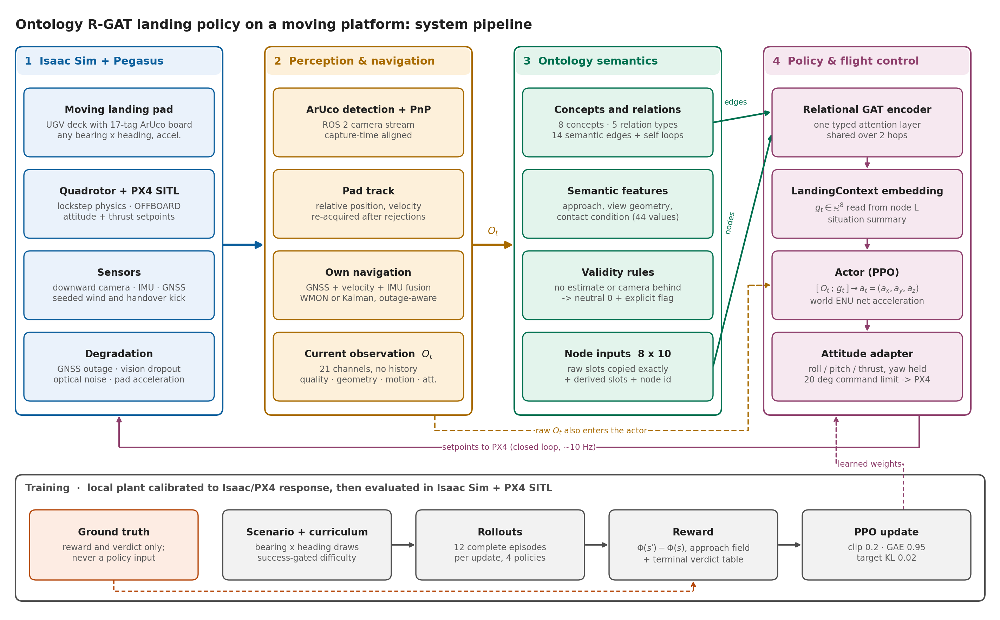
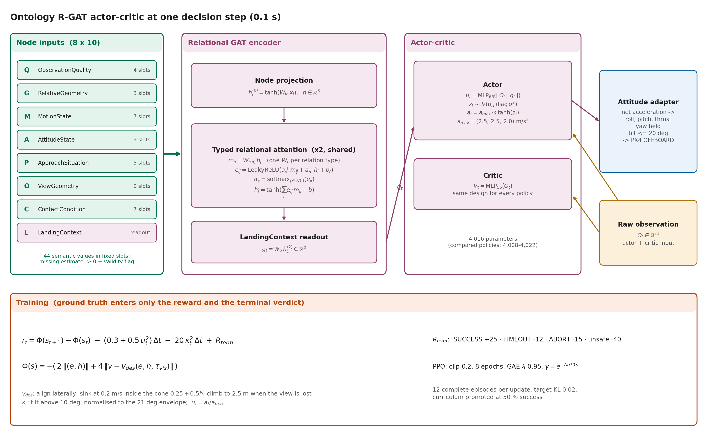
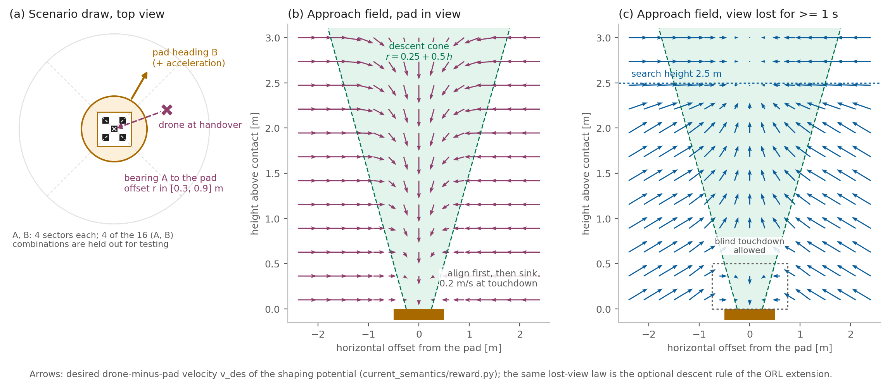
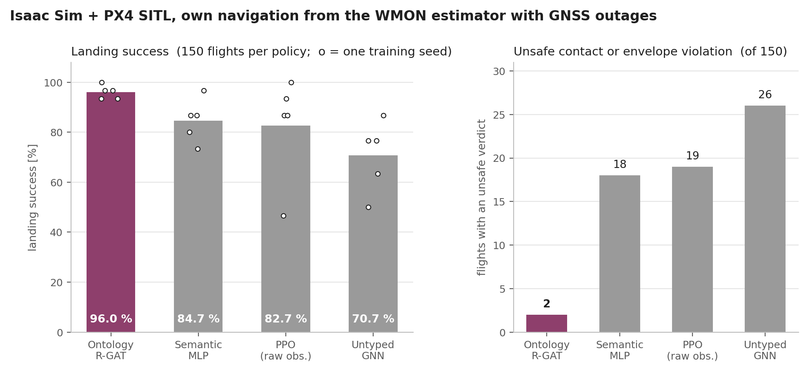
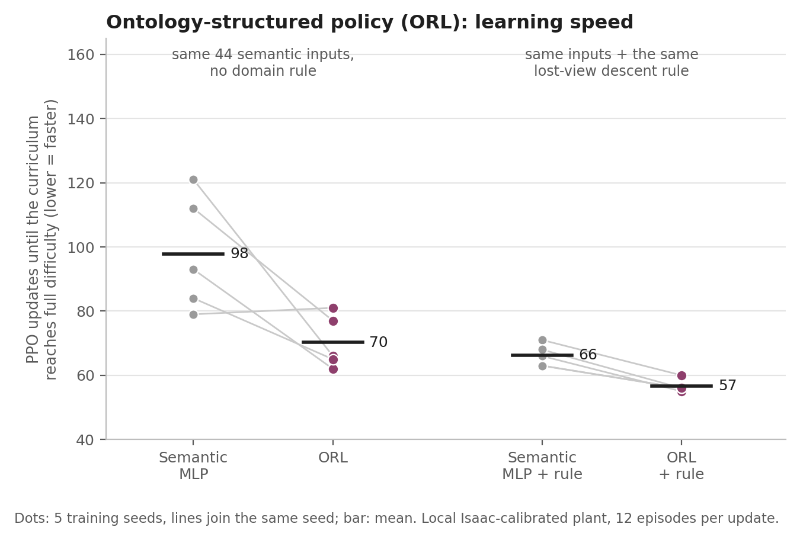

# 그림 모음

온톨로지 기반 R-GAT 착륙 정책의 구조, 학습 신호, 검증 결과를 보여 주는 그림이다.

- 모두 흰 배경 PNG(200 dpi)와 SVG로 저장한다. 그림 속 글자는 영문이다.
- 다이어그램은 코드에서 직접 읽어 그렸다.
- 결과 그림은 [`figure_data.json`](figure_data.json)만 읽는다. 이 파일은 `extract` 단계가 비행별 기록과 평가 요약에서 뽑은 것이다.
- 색은 다음 규칙으로 정했다.
  - 다이어그램: 단계마다 한 가지 색
  - 결과 그림: 제안 정책만 강조색, 나머지 정책은 회색
  - 관계 유형 다섯 가지: 색맹 안전성을 검사한 범주형 팔레트에 선 모양을 함께 써서 구분한다.

## 1. 시스템 파이프라인



Isaac Sim + Pegasus의 이동 패드와 PX4 SITL 쿼드로터에서 정책까지 이어지는 흐름은 다음과 같다.

1. ArUco 검출, 패드 추적, 자기 항법이 21채널 현재 관측 `O_t`를 만든다.
2. 온톨로지 단계는 `O_t`에서 44개 의미 특징과 8 × 10 노드 입력을 만든다.
3. R-GAT 인코더가 8차원 착륙 맥락 `g_t`를 낸다.
4. Actor가 `[O_t ; g_t]`에서 3축 순가속도를 정한다.
5. 자세 변환기가 이를 PX4 설정값으로 바꾼다.

아래 띠는 오프라인 학습 흐름이다. 참값은 보상과 판정에만 들어간다.

## 2. 정책 모델 (한 결정 시점)



- 노드 입력: 개념별 슬롯 수는 `current_semantics/features.py`에서 센다.
- 관계 어텐션 층: 노드 투영 뒤에 하나의 층을 두 번 적용하고, LandingContext를 판독한다.
- Actor·Critic의 식, 행동 한계, 파라미터 수
- 아래 띠: 보상(퍼텐셜 차 + 시간·제어·기울기 비용 + 종료 보상)과 PPO 설정

## 3. 온톨로지 그래프


간선과 관계 유형은 `current_semantics/graph.py`에서 그대로 읽었다. 노드 구성은 다음과 같다.

- 관측 상태 4개
- 착륙 상황 3개
- 결정 맥락 1개

관계 유형은 5가지이고, 의미 간선 14개와 자기 루프 8개가 있다. 노드 모서리의 숫자는 그 노드의 입력 슬롯 수이다.
Untyped GNN 비교 정책은 같은 간선에서 관계 이름만 지운 그래프를 쓴다.

## 4. 시나리오와 접근 속도장



- (a) 정책 인계 시점의 시나리오 추출. 패드 방위 A와 패드 진행 방향 B는 4개 구역씩이고, 16개 조합 중 4개는 시험용으로 학습에서 뺀다.
- (b), (c) 보상 퍼텐셜이 요구하는 드론−패드 상대 속도 `v_des`. `current_semantics/reward.py: desired_velocity`를 격자에서 직접 계산했다.
  - (b) 패드가 보이는 경우: 하강 원뿔 안에서만 하강한다.
  - (c) 시야를 1 s 이상 잃은 경우: 탐색 높이로 상승한다. 마지막 0.5 m, 0.75 m 이내 구간은 예외이다.

## 5. Isaac 폐루프 결과 (WMON 항법)



- 정책마다 150회 비행: 조건 3개 × 환경 10개 × 학습 시드 5개
- 왼쪽: 착륙 성공률. 점 하나는 학습 시드 하나(30회 비행)의 성공률이다.
- 오른쪽: 위험 판정(불안전 접지 + 기울기 한계 위반) 횟수

## 6. 항법 열화에 따른 성능


같은 케이스를 기준 항법, 칼만, WMON 세 가지 항법으로 비행한 성공률이다.
Semantic MLP는 세 항법 모두에서 학습된 시드 3개만 쓰므로 90회이다.

## 7. 온톨로지 구조 정책(ORL)의 학습 속도



커리큘럼이 최고 난이도에 도달할 때까지의 PPO 업데이트 수이다. 낮을수록 빠르다.
같은 44개 의미 입력의 MLP와 비교하며, 시야 상실 규칙이 없을 때와 같은 규칙을 넣었을 때를 따로 보인다.
점은 학습 시드이고, 선은 같은 시드를 잇는다.

## 다시 만들기

```bash
python3 Ontology_RGAT_UAV_RL_ISAAC_PX4/tools/make_doc_figures.py extract   # results/ → figure_data.json
python3 Ontology_RGAT_UAV_RL_ISAAC_PX4/tools/make_doc_figures.py all       # 그림 7개
python3 Ontology_RGAT_UAV_RL_ISAAC_PX4/tools/make_doc_figures.py graph     # 하나만
```
