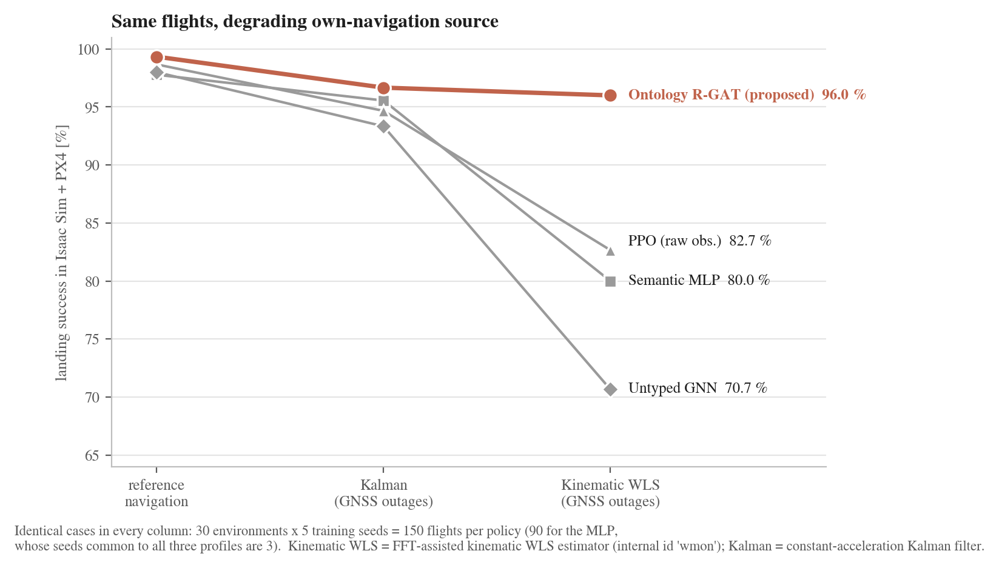

# 그림 모음

온톨로지 기반 R-GAT 착륙 정책의 구조, 학습 신호, 검증 결과를 보여 주는 그림이다.

- 형식: 모두 흰 배경 PNG(200 dpi)와 SVG로 저장한다. 그림 속 글자는 영문이며, 논문 그림 형식의 세리프 글꼴(Times 계열)을 쓴다.
- 다이어그램: 코드에서 직접 읽어 그렸다.
- 결과 그림: [`figure_data.json`](figure_data.json)만 읽는다. 이 파일은 `extract` 단계가 비행별 기록과 평가 요약에서 뽑은 것이다.
- 색 규칙:
  - 블록: 단계마다 파스텔 채움에 같은 색의 진한 테두리. 묶음은 파란 점선 상자로, 상세 패널은 점선으로 본 블록에 잇는다.
  - 결과 그림: 제안 정책만 강조색, 나머지 정책은 회색
  - 관계 유형 다섯 가지: 색맹 안전성을 검사한 범주형 팔레트에 선 모양을 함께 써서 구분한다.

## 1. 전체 아키텍처


- **위:** 장면 정보(UAV, 이동 패드, 카메라, 자기 항법 추정기 Self-Navigation Estimator, 자세)가 온톨로지 R-GAT 인코더를 거친다.
  - 인코더 순서: 의미 특징 생성기 φ → 노드 투영 → 관계 그래프 어텐션 2홉(같은 층 공유) → LandingContext 판독
  - 판독 결과 g_t는 원 관측 O_t와 이어 붙여 Actor에 들어간다.
  - Actor의 3축 순가속도는 자세·추력으로 바뀌어 PX4 OFFBOARD로 전달된다.
- **왼쪽 아래:** 인코더 블록
- **오른쪽:** 각 블록의 상세
  - 의미 특징과 8 × 10 노드 입력
  - 관계별 변환 W_r, 어텐션 점수, 들어오는 간선에 대한 softmax
  - 판독과 Actor 헤드

## 2. 시스템 파이프라인


Isaac Sim + Pegasus의 이동 패드와 PX4 SITL 쿼드로터에서 정책까지 이어지는 흐름은 다음과 같다.

1. ArUco 검출, 패드 추적, 자기 항법이 21채널 현재 관측 `O_t`를 만든다.
2. 온톨로지 단계가 44개 의미 특징과 8 × 10 노드 입력을 만든다.
3. R-GAT와 Actor가 3축 순가속도를 정한다.
4. 자세 변환기가 이를 PX4 설정값으로 바꾼다.

아래 띠는 오프라인 학습 흐름이다. 참값은 보상과 판정에만 들어간다.

## 3. 온톨로지 그래프


간선과 관계 유형은 `current_semantics/graph.py`에서 그대로 읽었다.

- 원 = 개념. 관측 상태 4개, 착륙 상황 3개, 결정 맥락 1개이다.
- 원 위의 숫자 = 그 개념의 입력 슬롯 수
- 점선 고리 = 자기 루프

Untyped GNN 비교 정책은 같은 간선에서 관계 이름만 지운 그래프를 쓴다.

## 4. 시나리오와 접근 속도장


- (a) 정책 인계 시점의 시나리오 추출. 패드 방위 A와 패드 진행 방향 B는 4개 구역씩이고, 16개 조합 중 4개는 시험용으로 학습에서 뺀다.
- (b), (c) 보상 퍼텐셜이 요구하는 드론−패드 상대 속도 `v_des`. `current_semantics/reward.py: desired_velocity`를 격자에서 직접 계산했다.

## 5. Isaac 폐루프 결과 (Kinematic WLS 자기 항법)


정책마다 Isaac Sim + PX4에서 비행한 착륙 성공률과 위험 판정(불안전 접지 + 기울기 한계 위반) 비율이다.
이때 자기 항법은 FFT-assisted kinematic WLS 추정기가 맡았다. 이 추정기는 저자가 별도 연구에서 개발한 것(내부 명칭 WMON)으로, 본 연구의 기여가 아니다.
파일 이름 `isaac_wmon_results`의 `wmon`은 결과 폴더와 맞춘 내부 식별자이다.
점 하나는 학습 시드 하나의 성공률이다.

## 6. 항법 열화에 따른 성능



같은 케이스를 세 가지 자기 항법으로 비행한 성공률이다.

- 기준 항법: PX4 EKF2 출력 그대로
- Kalman: 등가속도 칼만 필터(CA-KF)
- Kinematic WLS: FFT-assisted kinematic WLS 추정기, 내부 명칭 WMON

성공률은 원래 실험 기록에서 그대로 옮겼다.

## 다시 만들기

```bash
python3 Ontology_RGAT_UAV_RL_ISAAC_PX4/tools/make_doc_figures.py extract   # results/ → figure_data.json
python3 Ontology_RGAT_UAV_RL_ISAAC_PX4/tools/make_doc_figures.py all       # 모든 그림
python3 Ontology_RGAT_UAV_RL_ISAAC_PX4/tools/make_doc_figures.py overall   # 하나만
```
