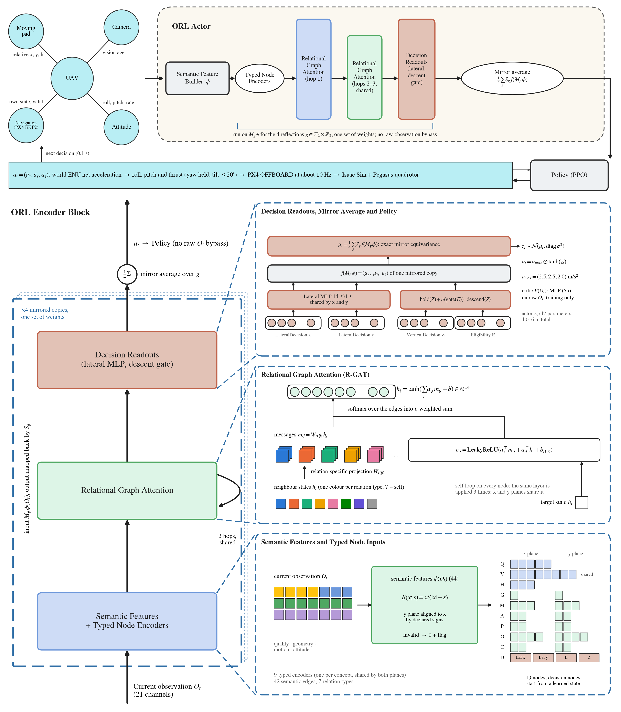
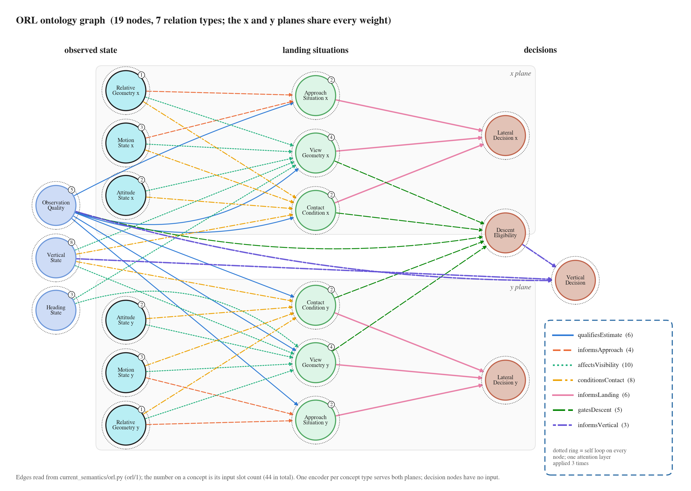

# 그림 모음

제안 정책 ORL(온톨로지를 정책 구조로 쓰는 R-GAT, `orl/1`)의 구조, 학습 신호, 검증 결과를 보여 주는 그림이다.

- 형식: 모두 흰 배경 PNG(200 dpi)와 SVG로 저장한다. 그림 속 글자는 영문이며, 논문 그림 형식의 세리프 글꼴(Times 계열)을 쓴다.
- 다이어그램: 코드에서 직접 읽어 그렸다. 노드·간선·슬롯 수·파라미터 수는 `current_semantics/orl.py`(`orl/1`)에서 읽는다.
- 색 규칙:
  - 블록: 단계마다 파스텔 채움에 같은 색의 진한 테두리. 묶음은 파란 점선 상자로, 상세 패널은 점선으로 본 블록에 잇는다.
  - 결과 그림: 제안 정책만 강조색, 나머지 정책은 회색
  - 관계 유형 일곱 가지: 색맹 안전성을 검사한 범주형 팔레트(7칸)에 선 모양을 함께 써서 구분한다.

## 1. 전체 아키텍처



- **위:** 장면 정보(UAV, 이동 패드, 카메라, 항법 상태(PX4 EKF2), 자세)가 ORL Actor를 거친다.
  - 순서: 의미 특징 생성기 φ → 개념별 노드 인코더 → 관계 그래프 어텐션 3홉(같은 층 공유) → 결정 판독(수평, 하강 게이트) → 거울 평균
  - 같은 가중치의 망을 네 가지 거울 반사 M_g φ에 돌리고, 출력을 S_g로 되돌려 평균한다(정확한 거울 등변성).
  - 원 관측 O_t가 그래프를 건너뛰어 Actor로 가는 경로는 없다. O_t는 학습 때 critic에만 들어간다.
  - 3축 순가속도는 자세·추력으로 바뀌어 PX4 OFFBOARD로 전달된다.
- **왼쪽 아래:** ORL 블록. 뒤의 겹친 상자는 같은 가중치로 도는 거울 복사본 4개를 뜻한다.
- **오른쪽:** 각 블록의 상세
  - 의미 특징 44개와 개념별 노드 입력. x·y 평면이 같은 인코더를 쓰고, y 평면은 선언된 부호로 x에 맞춘다.
  - 관계별 변환 W_r(관계 7개 + 자기 루프), 어텐션 점수, 들어오는 간선에 대한 softmax
  - 결정 판독: x·y가 공유하는 수평 MLP, 수직은 hold(Z) + σ(gate(E))·descend(Z), 그다음 거울 평균과 정책
  - Actor 2,747개, 전체 4,016개 파라미터(비교 정책과 같은 예산)

## 2. 시스템 파이프라인


Isaac Sim + Pegasus의 이동 패드와 PX4 SITL 쿼드로터에서 정책까지 이어지는 흐름은 다음과 같다.

1. ArUco 검출, 패드 추적, PX4 EKF2 자기 상태가 21채널 현재 관측 `O_t`를 만든다. 별도 항법 추정기는 쓰지 않는다.
2. 온톨로지 단계가 44개 의미 특징과 19개 노드의 입력을 만든다.
3. ORL 인코더, 결정 판독, 거울 평균이 3축 순가속도를 정한다.
4. 자세 변환기가 이를 PX4 설정값으로 바꾼다.

아래 띠는 오프라인 학습 흐름이다. 참값은 보상과 판정에만 들어가고, 원 관측 `O_t`는 critic에만 들어간다.

## 3. 온톨로지 그래프



노드, 간선, 관계 유형은 `current_semantics/orl.py`(`orl/1`)에서 그대로 읽었다.

- 원 = 노드 19개
  - 공유 상태 개념 3개(관측 품질, 수직 상태, 방위)
  - 평면마다 개념 6개(x 평면 위, 거울상인 y 평면 아래)
  - 결정 노드 4개(수평 결정 x·y, 하강 적격성, 수직 결정)
- 원 위의 숫자 = 그 개념의 입력 슬롯 수(합 44). 결정 노드는 입력이 없고 학습되는 초기 상태에서 시작한다.
- 점선 고리 = 자기 루프. 같은 어텐션 층을 3번 적용한다.
- 두 평면은 인코더와 관계 가중치를 모두 공유한다.

## 4. 시나리오와 접근 속도장


- (a) 정책 인계 시점의 시나리오 추출. 패드 방위 A와 패드 진행 방향 B는 4개 구역씩이고, 16개 조합 중 4개는 시험용으로 학습에서 뺀다.
- (b), (c) 보상 퍼텐셜이 요구하는 드론−패드 상대 속도 `v_des`. `current_semantics/reward.py: desired_velocity`를 격자에서 직접 계산했다.

## 보관된 결과 그림

이전 단계의 결과 그림 두 개(기존 R-GAT 정책의 Kinematic WLS 항법 조건 Isaac 결과, 항법별 성능 비교)와 그 수치 파일
`figure_data.json`은 2026-11-20에 `archive/non_orl_20261120.tar.zst`로 옮겼다. 저자의 별도 연구인 추정기 조건에 기대는
결과라 이 연구의 주장에 쓰지 않는다. ORL의 결과 그림은 학습 속도 확인 실험의 판정이 나온 뒤 추가한다.

## 다시 만들기

```bash
python3 Ontology_RGAT_UAV_RL_ISAAC_PX4/tools/make_doc_figures.py all       # 모든 그림
python3 Ontology_RGAT_UAV_RL_ISAAC_PX4/tools/make_doc_figures.py overall   # 하나만 (architecture, graph도 같은 방식)
```
